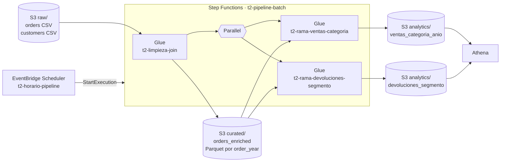

# README

Trabajo 2 · Parte A: pipeline batch con AWS Glue, AWS Step Functions y Amazon EventBridge Scheduler

- [README](#readme)
  - [Resumen](#resumen)
    - [Arquitectura](#arquitectura)
    - [Nombres de los recursos](#nombres-de-los-recursos)
    - [Estructura de esta carpeta](#estructura-de-esta-carpeta)
  - [Conceptos](#conceptos)
  - [Preparación](#preparación)
    - [Paso 0.1: Cuenta, región y alerta de presupuesto](#paso-01-cuenta-región-y-alerta-de-presupuesto)
    - [Paso 0.2: CloudFormation sin stacks](#paso-02-cloudformation-sin-stacks)
  - [Datos](#datos)
    - [Paso 1: Perfilar los datos de partida](#paso-1-perfilar-los-datos-de-partida)
    - [Paso 2: Generar los registros que faltan](#paso-2-generar-los-registros-que-faltan)
  - [Almacenamiento y permisos](#almacenamiento-y-permisos)
    - [Paso 3: Crear el bucket de S3](#paso-3-crear-el-bucket-de-s3)
    - [Paso 4: Subir los datos y los scripts](#paso-4-subir-los-datos-y-los-scripts)
    - [Paso 5: Dejar que Glue cree su rol](#paso-5-dejar-que-glue-cree-su-rol)
  - [Trabajos de Glue](#trabajos-de-glue)
    - [Paso 6: Crear el trabajo de Glue inicial](#paso-6-crear-el-trabajo-de-glue-inicial)
    - [Paso 7: Ejecutar el trabajo inicial y leer su log](#paso-7-ejecutar-el-trabajo-inicial-y-leer-su-log)
    - [Paso 8: Crear y probar los trabajos de las dos ramas](#paso-8-crear-y-probar-los-trabajos-de-las-dos-ramas)
  - [Orquestación](#orquestación)
    - [Paso 9: Crear la máquina de estados](#paso-9-crear-la-máquina-de-estados)
    - [Paso 10: Probar la máquina de estados a mano](#paso-10-probar-la-máquina-de-estados-a-mano)
    - [Paso 11: Crear el horario de EventBridge Scheduler](#paso-11-crear-el-horario-de-eventbridge-scheduler)
  - [Consulta](#consulta)
    - [Paso 12: Consultar las agregaciones con Athena](#paso-12-consultar-las-agregaciones-con-athena)
  - [Remove](#remove)
  - [Costos](#costos)
  - [Solución de problemas](#solución-de-problemas)
  - [Declaración de uso de IA](#declaración-de-uso-de-ia)

---

## Resumen

La parte A es un pipeline batch: cada vez que un horario lo dispara, procesa todas las órdenes de una tienda en línea con Apache Spark en AWS Glue y deja listos dos resúmenes para analítica.

1. Un **horario de Amazon EventBridge Scheduler** inicia una **máquina de estados de AWS Step Functions**.
2. La máquina ejecuta el **trabajo de Glue inicial** (`t2-limpieza-join`), un script de PySpark que lee las órdenes y los clientes en CSV desde S3, **limpia** las órdenes, las **une (join)** con los clientes por `customer_id` y escribe el resultado en **Parquet particionado por `order_year`**.
3. Si el trabajo inicial termina bien, la máquina ejecuta **a la vez dos ramas** (un estado `Parallel`), cada una un trabajo de Glue que calcula una agrupación distinta y la escribe en Parquet:
   - Rama 1 (`t2-rama-ventas-categoria`): **¿qué categoría de producto genera más ingresos netos cada año, y qué parte del ingreso del año representa?**
   - Rama 2 (`t2-rama-devoluciones-segmento`): **¿qué segmento de clientes (nivel de membresía y grupo de ingresos) devuelve más, cuánto dinero se devuelve y por qué motivo?**
4. Las dos agrupaciones se consultan con **Amazon Athena**.

Todo se crea **a mano en la consola de AWS**, sin CloudFormation, Serverless Framework ni Terraform.

Los datos de partida son `orders.csv` (1.000.000 de órdenes) y `customers.csv` (500.000 clientes). Para trabajar con al menos 5.000.000 de registros, el script `generador/generar_orders.py` genera 4.531.599 líneas más. En total el pipeline lee **5.531.599 registros** y, después de limpiar y unir, escribe **5.224.028**.

### Arquitectura



### Nombres de los recursos

Todos los recursos van en la región **`us-east-2` (Ohio)**. Use exactamente estos nombres: los scripts, las políticas y las consultas los usan.

| Recurso | Nombre |
| --- | --- |
| Bucket de S3 | `aws-glue-t2-<ACCOUNT_ID>` (el número de cuenta de 12 dígitos, porque los nombres de bucket son únicos en todo AWS). Debe empezar por `aws-glue-`: así el rol que crea Glue tiene acceso sin agregarle permisos (paso 5) |
| Rol de IAM de Glue | `AWSGlueServiceRole` (lo crea la consola de Glue) |
| Trabajo de Glue inicial | `t2-limpieza-join` |
| Trabajo de Glue, rama 1 | `t2-rama-ventas-categoria` |
| Trabajo de Glue, rama 2 | `t2-rama-devoluciones-segmento` |
| Rol de IAM de Step Functions | `StepFunctions-role-...`, por ejemplo `StepFunctions-role-605ac744` (lo crea la consola de Step Functions con un sufijo aleatorio; anótelo) |
| Máquina de estados | `t2-pipeline-batch` |
| Rol de IAM del horario | `Amazon_EventBridge_Scheduler_SFN_...` (lo crea la consola del horario) |
| Horario | `t2-horario-pipeline` |
| Base de datos de Athena | `trabajo2` |

Carpetas (prefijos) dentro del bucket:

| Prefijo | Contenido | Lo escribe |
| --- | --- | --- |
| `raw/orders/` | `orders.csv` y los 89 CSV generados | Usted (paso 4) |
| `raw/customers/` | `customers.csv` | Usted (paso 4) |
| `scripts/` | Los tres scripts de PySpark | Usted (paso 4) |
| `temp/` | Archivos temporales de Glue | Glue |
| `curated/orders_enriched/` | Órdenes limpias y unidas, Parquet, `order_year=2019/` … `order_year=2026/` | Trabajo inicial |
| `analytics/ventas_categoria_anio/` | Agrupación de la rama 1, Parquet | Rama 1 |
| `analytics/devoluciones_segmento/` | Agrupación de la rama 2, Parquet | Rama 2 |
| `athena-results/` | Resultados de las consultas | Athena |

### Estructura de esta carpeta

```text
parte_a/
├── README.md                         # este paso a paso
├── generador/
│   └── generar_orders.py             # aumenta orders.csv hasta superar 5 millones
├── glue/
│   ├── t2_limpieza_join.py           # trabajo inicial: limpieza, join, Parquet
│   ├── t2_rama_ventas_categoria.py   # rama 1
│   └── t2_rama_devoluciones_segmento.py  # rama 2
├── stepfunctions/
│   └── t2-pipeline-batch.asl.json    # definición de la máquina de estados
├── athena/
│   └── consultas.sql
└── datos/                            # no se sube a GitHub (ver .gitignore)
    ├── orders.csv
    ├── customers.csv
    └── generados/                    # salida del generador
```

`orders.csv` pesa 101 MB y GitHub rechaza archivos de más de 100 MB, por eso `datos/` está en `.gitignore`. El generador es determinista: con la misma semilla se obtienen exactamente los mismos archivos, así que no hace falta versionarlos.

---

## Conceptos

Estos términos se usan en todos los pasos.

| Concepto | Qué es, en este trabajo |
| --- | --- |
| **Amazon S3** | Almacenamiento de objetos. Un *bucket* es el contenedor; las "carpetas" son en realidad prefijos del nombre de cada objeto (`raw/orders/orders.csv`). Es el *data lake*: entrada y salida de todo el pipeline. |
| **AWS Glue** | Servicio sin servidores que ejecuta trabajos de Apache Spark. No se crean ni se administran máquinas: se indica cuántos *workers* se quieren y Glue los arranca, corre el script y los apaga. |
| **Trabajo de Glue (job)** | La definición: script, rol, versión, workers y parámetros. Cada vez que se ejecuta produce un *job run* con su estado (`Running`, `Succeeded`, `Failed`) y sus logs. |
| **Worker y DPU** | Un *worker* `G.1X` es una máquina de 4 vCPU y 16 GB de memoria, equivalente a 1 DPU (*Data Processing Unit*). Glue cobra por DPU-hora. Uno de los workers hace de *driver* (coordina) y los demás de *executors* (procesan). |
| **PySpark** | La API de Python de Spark. Un *DataFrame* es una tabla distribuida en particiones; las transformaciones (`where`, `select`, `join`) son *perezosas* y solo se ejecutan cuando hay una acción (`count`, `write`). |
| **Parquet** | Formato de archivo **columnar** y comprimido. Guarda el esquema (tipos de datos) dentro del archivo y permite leer solo las columnas que una consulta necesita. Los 5,5 millones de filas pasan de ~540 MB en CSV a ~150 MB en Parquet. |
| **Partición** | Dividir los datos en carpetas por el valor de una columna (`order_year=2024/`). Una consulta que filtra por esa columna lee solo las carpetas que necesita (*partition pruning*). |
| **Join** | Unir dos tablas por una columna en común. Aquí, `orders` con `customers` por `customer_id`, un *inner join*: se quedan las órdenes cuyo cliente existe. |
| **AWS Step Functions** | Orquestador: una *máquina de estados* define pasos (estados) y el orden en que se ejecutan. Se escribe en JSON con el lenguaje *Amazon States Language* (ASL). |
| **Estado `Task` con `.sync`** | `arn:aws:states:::glue:startJobRun.sync` inicia el trabajo de Glue **y espera a que termine**. Sin `.sync`, la máquina seguiría apenas lo inicia, sin saber si terminó bien. |
| **Estado `Parallel`** | Ejecuta varias ramas a la vez y solo continúa cuando **todas** terminan. Si una falla, falla el estado completo. |
| **Retry y Catch** | `Retry` reintenta un estado que falló; `Catch` decide a qué estado ir si sigue fallando. |
| **Amazon EventBridge Scheduler** | Servicio de horarios: en una fecha u hora (expresión `cron` o `rate`) llama a una API de AWS, aquí `StartExecution` de Step Functions. |
| **Rol de IAM** | Identidad que un **servicio** asume para actuar. Tiene dos políticas: la **de confianza** (*trust policy*: quién puede asumir el rol, por ejemplo `glue.amazonaws.com`) y la **de permisos** (qué puede hacer, por ejemplo leer el bucket). Aquí los tres roles los crean las consolas de Glue, Step Functions y EventBridge Scheduler; no se escriben a mano. |
| **Amazon Athena** | Motor SQL sin servidores que consulta archivos en S3. No guarda datos: la tabla es solo metadatos (esquema y ubicación) en el **AWS Glue Data Catalog**. Cobra por datos escaneados. |
| **CloudFormation** | Servicio de infraestructura como código. Aquí **no se usa**: todos los recursos se crean desde la consola de cada servicio. |

---

## Preparación

### Paso 0.1: Cuenta, región y alerta de presupuesto

1. Inicie sesión en <https://console.aws.amazon.com/>. Use un usuario de IAM con permisos de administrador, o el usuario raíz solo si no tiene otro (en ese caso, active MFA).
2. Arriba a la derecha, en el selector de región, elija **US East (Ohio) us-east-2**. Revise que siga ahí en cada consola: cada servicio recuerda su propia región y los recursos de una región no se ven desde otra. Las consolas de **IAM**, **Billing and Cost Management** y la lista de buckets de **S3** muestran **Global**: son servicios globales y es normal.
3. Anote el **Account ID** (12 dígitos): menú del usuario, arriba a la derecha. A partir de aquí, `<ACCOUNT_ID>` es ese número y `<BUCKET>` es `aws-glue-t2-<ACCOUNT_ID>`.
4. Cree una alerta de presupuesto, porque Glue **no es gratuito** (ver [Costos](#costos)): **Billing and Cost Management** → **Budgets** → **Create budget** → **Use a template (simplified)** → **Monthly cost budget**, con un monto de `10` USD y su correo. Así recibe un aviso si algo se queda corriendo.

Esperado: la región `us-east-2` en todas las consolas y un presupuesto en **Budgets**.

### Paso 0.2: CloudFormation sin stacks

Abra **CloudFormation** → **Stacks** en `us-east-2`. Si quedan stacks de trabajos anteriores que ya no usa, elimínelos: seleccione cada uno → **Delete**. Si un stack no se deja borrar porque su bucket tiene objetos, vacíe primero el bucket en S3 (**Empty**) y vuelva a intentar. Si trabajó en otra región (por ejemplo `us-east-1`), cambie el selector a esa región y revise también allí: CloudFormation solo muestra los stacks de la región elegida.

Esperado: la lista vacía (**No stacks**) con el filtro de estado en **Active**; los stacks ya borrados solo aparecen si se elige el filtro **Deleted**.

Ninguno de los pasos de este README crea stacks: todos los recursos se crean desde la consola de cada servicio.

---

## Datos

### Paso 1: Perfilar los datos de partida

Antes de generar datos hay que entender los que existen: el generador debe producir registros que se parezcan a los originales.

Copie `orders.csv` y `customers.csv` en `trabajo2/parte_a/datos/` y ejecute el perfilamiento con cualquier Python que tenga pandas.

En **PowerShell (Windows)**, el comando es `python` o `py`, no `python3`: en Windows, `python3` es un acceso directo a la Microsoft Store y responde "no se encontró Python". Si `python` también responde eso, use `py`. Ubíquese en la carpeta `parte_a` (la terminal debe terminar en `...\trabajo2\parte_a>`) y pegue esta **única línea** completa:

```powershell
python -c "import pandas as pd; o = pd.read_csv('datos/orders.csv'); c = pd.read_csv('datos/customers.csv'); print(o.shape, c.shape); print(o.describe(include='all').T); print(o.isna().sum()); print(o.groupby(['product_category', 'product_name']).size()); print(pd.crosstab(o.order_status, o.returned)); print('customer_id de orders que existen en customers:', o.customer_id.isin(c.customer_id).mean())"
```

En **bash** (Linux, macOS o un contenedor):

```bash
cd trabajo2/parte_a
python3 -c "
import pandas as pd
o = pd.read_csv('datos/orders.csv'); c = pd.read_csv('datos/customers.csv')
print(o.shape, c.shape)
print(o.describe(include='all').T)
print(o.isna().sum())
print(o.groupby(['product_category', 'product_name']).size())
print(pd.crosstab(o.order_status, o.returned))
print('customer_id de orders que existen en customers:', o.customer_id.isin(c.customer_id).mean())
"
```

Si pandas no está instalado: `python -m pip install pandas` en Windows o `python3 -m pip install pandas` en bash.

Lo que muestra, y que el generador reproduce:

| Columna | Hallazgo |
| --- | --- |
| Tamaño | `orders.csv`: 1.000.000 filas y 17 columnas. `customers.csv`: 500.000 filas y 17 columnas. |
| `order_id` | Único, de 5.000.001 a 6.000.000. No hay duplicados. |
| `customer_id` | De 1.000.001 a 1.500.000. El 100 % existe en `customers.csv`: es la **columna en común** del join. |
| `order_date` | De 2019-01-01 a 2026-05-24, ~11.000 órdenes por mes, distribución uniforme. |
| `product_category` / `product_name` | 5 categorías con 3 productos cada una (15 productos), con la misma frecuencia. |
| `quantity` | Entero de 1 a 5. |
| `unit_price` | De 100 a 50.000, uniforme, dos decimales. |
| `discount_percent` | 0, 5, 10, 15, 20, 25 o 30. |
| `order_amount` | Siempre `round(quantity × unit_price × (1 − discount_percent / 100), 2)`. |
| `payment_method` | `COD`, `Credit Card`, `Debit Card`, `UPI`, `Wallet`, uniforme. |
| `order_status` / `returned` | Un tercio cada estado (`Cancelled`, `Delivered`, `Returned`); `returned = Yes` si y solo si el estado es `Returned`. |
| `return_reason` | Solo en las devueltas; **1 de cada 5 devoluciones no tiene motivo** (valor vacío). |
| `seller_rating` / `customer_rating` | 3,0 a 5,0 en pasos de 0,1 / entero de 1 a 5. |
| Valores nulos | Ninguno, salvo `return_reason`. |

Conclusión: los datos de partida son **sintéticos y casi perfectamente uniformes** y no tienen errores, salvo los motivos de devolución vacíos. Por eso el generador inyecta defectos a propósito: sin ellos, el paso de limpieza no tendría nada que hacer.

### Paso 2: Generar los registros que faltan

#### Cómo genera los datos

`generador/generar_orders.py`:

| Elemento | Para qué |
| --- | --- |
| `rng = random.Random(seed)` con semilla 42 | **Determinismo**: la misma semilla produce los mismos archivos, así cualquiera reproduce los datos exactos. |
| `CATALOG`, `PAYMENT_METHODS`, `STATUSES`, `DISCOUNTS`, con los valores medidos en el paso 1 | Que los datos nuevos tengan los mismos dominios que los originales. |
| Un archivo `orders-YYYY-MM.csv` por mes | Archivos de tamaño manejable (~5 MB) que Spark lee en paralelo, uno por tarea. |
| `customer_id` leídos de `customers.csv` | Que el join funcione con los clientes existentes. |
| Primer `order_id` = mayor de `orders.csv` + 1 (6.000.001) | No repetir identificadores. |
| Defectos inyectados (tabla siguiente) | Darle trabajo real a la limpieza y al join. |

Las columnas son las mismas 17 de `orders.csv`. Defectos que inyecta, sobre las líneas generadas:

| Defecto | Fracción | Ejemplo | Qué hace la limpieza |
| --- | --- | --- | --- |
| `duplicate` | 3 % | La misma línea dos veces | Descarta la copia |
| `invalid_date` | 1 % | `''`, `2024-02-30`, `2025-13-01`, `18/01/2020` | Descarta |
| `invalid_quantity` | 1 % | `0`, `-1`, `-2` | Descarta |
| `amount_mismatch` | 2 % | `order_amount` con ±1.000 o +5.000 | **Corrige**: recalcula el monto |
| `missing_customer` | 1 % | `customer_id` vacío | Descarta |
| `unknown_customer` | 1 % | `customer_id` mayor que 1.500.000 | El *inner join* lo descarta |
| `dirty_text` | 2 % | `'  beauty '`, `'DEBIT CARD  '` | **Corrige**: `Beauty`, `Debit Card` |

#### Ejecutarlo

Solo usa la biblioteca estándar de Python 3, así que corre sin instalar nada.

En **PowerShell (Windows)**, con `python` (o `py`), no `python3`:

```powershell
cd trabajo2/parte_a
python generador/generar_orders.py --orders-csv datos/orders.csv --customers-csv datos/customers.csv --output datos/generados
```

En **bash**:

```bash
cd trabajo2/parte_a
python3 generador/generar_orders.py --orders-csv datos/orders.csv --customers-csv datos/customers.csv --output datos/generados
```

Esperado, después de 1 a 2 minutos:

```text
customers.csv: 500000 clientes
primer order_id generado: 6000001
generadas: 4400000 órdenes, 4531599 líneas, 89 archivos
  duplicate: 131599
  invalid_date: 43600
  invalid_quantity: 44025
  amount_mismatch: 87937
  missing_customer: 44236
  unknown_customer: 44111
  dirty_text: 88079
Archivos escritos en datos/generados
```

y 89 archivos, de `orders-2019-01.csv` a `orders-2026-05.csv`, de unos 438 MB en total.

Cuentas: `1.000.000` originales + `4.531.599` generadas = **5.531.599 registros de partida**. Se generan 4.400.000 órdenes, y no solo 4.000.000, para que **después** de limpiar sigan quedando más de 5 millones (5.224.028).

---

## Almacenamiento y permisos

### Paso 3: Crear el bucket de S3

1. Consola → **S3** → **Buckets** → **Create bucket**.
2. **AWS Region**: **US East (Ohio) us-east-2**. Revíselo: la región del bucket no se puede cambiar después, y si queda en otra región que Glue y Athena, se paga transferencia entre regiones y Athena puede fallar al escribir sus resultados.
3. **Bucket type**: **General purpose**.
4. **Bucket name**: `aws-glue-t2-<ACCOUNT_ID>`, por ejemplo `aws-glue-t2-123456789012`.
5. **Object Ownership**: **ACLs disabled (recommended)**.
6. **Block Public Access settings for this bucket**: deje marcado **Block all public access**. Nadie fuera de la cuenta necesita leer estos datos.
7. **Bucket Versioning**: **Disable**. Con versiones, al borrar quedarían copias ocultas que se siguen cobrando.
8. **Default encryption**: **Server-side encryption with Amazon S3 managed keys (SSE-S3)**, que es la opción por defecto y no tiene costo.
9. **Create bucket**.
10. Abra el bucket y, con **Create folder**, cree: `raw`, `scripts`, `temp`, `athena-results`. Dentro de `raw`, cree `orders` y `customers`. Las demás carpetas las crean Glue y Athena.

Esperado: el bucket en la lista, región **US East (Ohio) us-east-2**, con las carpetas `raw/orders/`, `raw/customers/`, `scripts/`, `temp/` y `athena-results/`.

### Paso 4: Subir los datos y los scripts

1. Abra `raw/orders/` → **Upload** → **Add files** → seleccione `datos/orders.csv` **y** los 89 archivos de `datos/generados/` (Ctrl+A dentro de la carpeta). Todos quedan en el mismo prefijo, porque Spark lee todos los CSV de una carpeta, pero **no** los de sus subcarpetas.
2. **Upload**. Son ~540 MB: deje la pestaña abierta hasta que diga **Upload succeeded** (con una conexión de 20 Mbps tarda unos 4 minutos).
3. Abra `raw/customers/` → **Upload** → `datos/customers.csv`.
4. Abra `scripts/` → **Upload** → los tres archivos de `glue/`: `t2_limpieza_join.py`, `t2_rama_ventas_categoria.py` y `t2_rama_devoluciones_segmento.py`.

Esperado: `raw/orders/` con **90 objetos** (al marcar la casilla de selección de todos, la consola muestra cuántos son), `raw/customers/` con 1 y `scripts/` con 3.

### Paso 5: Dejar que Glue cree su rol

Todo servicio de AWS que actúa sobre otros recursos (Glue leyendo S3, Step Functions iniciando Glue, el horario iniciando la máquina) necesita un **rol de IAM**: una identidad con permisos que ese servicio asume. Aquí, sin infraestructura como código, los roles se dejan crear **por la consola de cada servicio**, con un clic, sin escribir políticas en IAM.

Para Glue:

1. Consola → **AWS Glue** → menú izquierdo **Getting started** → en **Prepare your account for AWS Glue**, **Set up IAM permissions**.
2. En la pantalla para elegir usuarios o roles (identidades): no marque nada, su usuario ya es administrador. **Next**.
3. En la pantalla de acceso a S3 (**Choose S3 locations**): **No change**. **Next**. No hace falta: el bucket se llama `aws-glue-...` (paso 3) y el rol estándar ya puede leer y escribir los buckets con ese prefijo.
4. **Choose a default service role**: **Standard service role**. **Next**.
5. **Review and apply** → **Apply changes**.

Glue crea el rol **`AWSGlueServiceRole`**, con la política administrada del mismo nombre. Esa política permite, entre otras cosas, `s3:GetObject`, `s3:PutObject` y `s3:DeleteObject` sobre `arn:aws:s3:::aws-glue-*/*`, y escribir los logs en `/aws-glue/*` de CloudWatch. `DeleteObject` es necesario porque los trabajos escriben con `mode('overwrite')`, que borra la salida anterior.

Esperado: en **IAM** → **Roles** aparece `AWSGlueServiceRole`. Al abrirlo se ven sus dos partes: **Trust relationships** (quién puede asumirlo: `glue.amazonaws.com`) y **Permissions** (qué puede hacer).

---

## Trabajos de Glue

### Paso 6: Crear el trabajo de Glue inicial

#### Qué hace el script `t2_limpieza_join.py`

Está dividido en pasos numerados que imprimen sus conteos en el log:

| Paso | Qué hace | Por qué |
| --- | --- | --- |
| `[1]` Lectura | Lee las órdenes **todas como texto** (`string`) y los clientes con su esquema | Si se leyera `quantity` como entero, un valor sucio se perdería sin saber por qué. Leyendo texto, la limpieza decide qué hacer con cada valor. Además, dar el esquema evita que Spark recorra los datos para adivinarlo. |
| `[2]` Duplicados exactos | `dropDuplicates()` | Una fila idéntica es la misma orden enviada dos veces. |
| `[3]` Tipos y textos | `try_cast` a número, `try_to_timestamp` para la fecha, y `canonical()` que lleva los textos a su forma oficial (`'  beauty '` → `Beauty`) | **Corrige** lo que se puede corregir. Glue 6.0 usa Spark 4, con el modo ANSI activo: un `cast()` de un texto inválido **detiene el trabajo con un error**. `try_cast` devuelve `null` en vez de fallar. |
| `[4]` Reglas de validez | Descarta las filas con `order_id`, `customer_id` o `order_date` nulos o inválidos, productos fuera del catálogo, `quantity` fuera de 1 a 5, `unit_price` no positivo, descuento fuera de 0 a 100 o valores fuera de dominio. Cuenta cuántas descarta cada regla | **Descarta** lo que no se puede corregir. |
| `[5]` Correcciones | Recalcula `order_amount` cuando difiere en más de 1 del cálculo; deriva `returned` de `order_status`; pone `Not Specified` en las devoluciones sin motivo | Diferencias de centavos son redondeo; diferencias mayores son errores. |
| `[6]` Duplicados por `order_id` | `dropDuplicates(['order_id'])` | La llave de una orden no se puede repetir aunque el contenido cambie. |
| `[7]` Join | `left_anti` para contar las órdenes cuyo cliente no existe, y luego `inner join` con `customers` por `customer_id`. Se agregan edad, género, ciudad, membresía, grupo de ingresos, etc. **No** se agregan nombre y apellido | Las órdenes de un cliente inexistente no se pueden analizar por segmento. Nombre y apellido son datos personales que el análisis no necesita. |
| `[8]` Escritura | Agrega `order_year`, escribe Parquet con `partitionBy('order_year')` en modo `overwrite`, y vuelve a leer lo escrito para contarlo | `repartition('order_year')` deja un archivo por año en vez de muchos archivos pequeños. `overwrite` hace que cada ejecución del horario reemplace la anterior en vez de duplicarla. |

<a id="por-qué-order_year"></a>

#### Por qué se particiona por `order_year`

- **Es el filtro más común**: casi toda pregunta de analítica de ventas se hace por periodo ("ventas de 2025", "últimos dos años"). Con la partición, una consulta con `WHERE order_year = 2025` lee solo una carpeta de ocho. El paso 12 lo demuestra con el **Data scanned** de Athena.
- **Cardinalidad baja y particiones balanceadas**: 8 valores (2019 a 2026), unos 706.000 registros (~20 MB en Parquet) por año, salvo 2026, que va hasta mayo.
- **Evita el problema de los archivos pequeños**: particionar por `order_date` daría ~2.700 carpetas de ~2.000 filas; por `customer_id`, 500.000 carpetas. Miles de archivos diminutos hacen más lento a Spark y a Athena, que pagan un costo fijo por abrir cada archivo.
- **Alternativa descartada**: `product_category` tiene solo 5 valores y también sería válida, pero la rama 1 agrupa por año y las consultas por periodo son más frecuentes que por categoría.

#### Crearlo en la consola

1. Consola → **AWS Glue** → menú izquierdo **ETL jobs** (el título, no sus subopciones **Visual ETL**, **Notebooks** ni **Job run monitoring**). En la página que se abre, en la sección **Create job** de arriba, elija **Script editor**. No está en el menú izquierdo: es una de las tres opciones de esa sección (**Visual ETL**, **Notebook**, **Script editor**).
2. En la ventana: **Engine**: **Spark**; **Options**: **Upload script** → **Choose file** → `glue/t2_limpieza_join.py` → **Create script**. El script queda en el editor de la pestaña **Script**.
3. Arriba a la izquierda, cambie el nombre `Untitled job` por `t2-limpieza-join`.
4. Pestaña **Job details**:

   | Campo | Valor | Por qué |
   | --- | --- | --- |
   | **IAM Role** | `AWSGlueServiceRole` | El rol del paso 5 |
   | **Type** | Spark | Es un trabajo de Spark (no Ray ni Python shell) |
   | **Glue version** | **Glue 6.0** (Spark 4.1.1, Python 3.13) | La versión actual, con un precio por DPU menor que las anteriores |
   | **Language** | Python 3 | |
   | **Worker type** | G.1X (4 vCPU, 16 GB) | El más pequeño para Spark: alcanza para 540 MB |
   | **Automatically scale the number of workers** | Desmarcado | Para que el costo sea predecible |
   | **Requested number of workers** | `4` | 1 *driver* + 3 *executors* (12 núcleos). Con 2 tardaría el doble y costaría lo mismo |
   | **Generate job insights** | Puede quedar marcado | |
   | **Job bookmark** | **Disable** | Los *bookmarks* procesan solo archivos nuevos; aquí cada ejecución reprocesa todo y sobrescribe |
   | **Flex execution** | Desmarcado | Flex es más barato, pero puede demorar en arrancar |
   | **Number of retries** | `0` | Los reintentos los hace Step Functions |
   | **Job timeout (minutes)** | `30` | Si algo se cuelga, se detiene y no sigue cobrando |

5. Abra **Advanced properties**:

   | Campo | Valor |
   | --- | --- |
   | **Script filename** | `t2_limpieza_join.py` |
   | **Script path** | `s3://<BUCKET>/scripts/` |
   | **Spark UI** | Desmarcado (evita que Glue cree otro bucket para sus logs) |
   | **Maximum concurrency** | `1` |
   | **Temporary path** | `s3://<BUCKET>/temp/` |

   Si no cambia **Script path** y **Temporary path**, Glue crea un bucket propio llamado `aws-glue-assets-<ACCOUNT_ID>-us-east-2`. No es grave, pero es un recurso más que hay que borrar al final.

6. En **Job parameters** → **Add new parameter**, tres veces (la clave lleva los dos guiones):

   | Key | Value |
   | --- | --- |
   | `--input_orders` | `s3://<BUCKET>/raw/orders/` |
   | `--input_customers` | `s3://<BUCKET>/raw/customers/` |
   | `--output_path` | `s3://<BUCKET>/curated/orders_enriched/` |

   El script los lee con `getResolvedOptions(sys.argv, [...])`. Así el mismo script sirve para otro bucket sin editar el código.
7. **Save** (arriba a la derecha).

Esperado: el mensaje **Successfully created job** y el trabajo `t2-limpieza-join` en **ETL jobs**. En S3, `scripts/t2_limpieza_join.py` sigue siendo el script (si la consola lo sobrescribió al guardar, es el mismo contenido).

Si en `scripts/` aparece además una copia con otro nombre (por ejemplo `t2-limpieza_join.py`, con guion), la creó la consola al guardar. Revise en **Job details** → **Advanced properties** que **Script filename** sea `t2_limpieza_join.py`; si no, corríjalo y **Save**. Luego borre la copia en S3. Lo mismo aplica a las ramas del paso 8.

### Paso 7: Ejecutar el trabajo inicial y leer su log

1. Con el trabajo abierto, **Run**. Vaya a la pestaña **Runs**.
2. El estado pasa por **Starting** → **Running** → **Succeeded**. Esperado: entre 4 y 8 minutos (Glue tarda casi un minuto en arrancar los workers). También se puede seguir desde el menú izquierdo **ETL jobs** → **Job run monitoring**: muestra todas las ejecuciones de todos los trabajos, las que están en **Running** y las terminadas, con su hora de inicio, duración y DPU-horas consumidas. Actualice con el botón ↻. Una ejecución que falla en menos de un minuto casi siempre es un problema de parámetros (ver [Solución de problemas](#solución-de-problemas)).
3. Para ver el log de la ejecución, vaya a la consola de **CloudWatch** → menú izquierdo (Registros) **Administración de registros** (*Log management*) → grupo de registros `/aws-glue/jobs/output`, donde quedan los `print` del script. Dentro del grupo, abra el *log stream* de la **última ejecución**: el de **Last event time** más reciente, cuyo nombre empieza por el **Run ID** (`jr_...`) que muestra la pestaña **Runs** de Glue. Para ir directo a las líneas, escriba `Registros` en **Filter events**.

Esperado, en el log (estos valores son de una ejecución real del mismo script con PySpark 4.1.1, la versión de Spark de Glue 6.0, sobre los mismos datos):

```text
[1] Registros leídos de orders: 5531599
[1] Registros leídos de customers: 500000
[2] Duplicados exactos descartados: 131599
[3] Registros con textos por normalizar (espacios, mayúsculas): 88079
[4] Registros descartados por regla:
      customer_id vacío o no numérico: 44236
      order_date vacía o inválida: 43600
      quantity fuera de 1 a 5: 44025
[5] order_amount corregidos (no cuadraban): 87937
[6] Registros válidos después de limpiar: 5268139
[7] Órdenes sin cliente en customers (descartadas): 44111
[8] Registros escritos en Parquet: 5224028
      order_year=2019: 705538
      order_year=2020: 708197
      order_year=2021: 707125
      order_year=2022: 706283
      order_year=2023: 707295
      order_year=2024: 706154
      order_year=2025: 705251
      order_year=2026: 278185
```

Cómo cuadran:

```text
5.531.599 leídos
 − 131.599 duplicados exactos          (= duplicate del generador)
 −  44.236 sin customer_id             (= missing_customer)
 −  43.600 fecha inválida              (= invalid_date)
 −  44.025 cantidad inválida           (= invalid_quantity)
 = 5.268.139 válidos
 −  44.111 cliente inexistente         (= unknown_customer, descartado por el join)
 = 5.224.028 escritos en Parquet
```

Cada número coincide con el defecto que inyectó el generador: es la prueba de que la limpieza encuentra exactamente lo que se ensució. Los 87.937 montos y 88.079 textos se **corrigen**, no se descartan.

4. En S3, abra `curated/orders_enriched/`. Esperado: 8 carpetas `order_year=2019/` … `order_year=2026/`, cada una con un archivo `part-...snappy.parquet` (~20 MB, ~8 MB la de 2026), y un objeto `_SUCCESS` que Spark escribe al terminar bien.

### Paso 8: Crear y probar los trabajos de las dos ramas

Repita el paso 6 dos veces, con estas diferencias:

| Campo | Rama 1 | Rama 2 |
| --- | --- | --- |
| Script | `glue/t2_rama_ventas_categoria.py` | `glue/t2_rama_devoluciones_segmento.py` |
| Nombre del trabajo | `t2-rama-ventas-categoria` | `t2-rama-devoluciones-segmento` |
| **Requested number of workers** | `2` | `2` |
| **Job timeout (minutes)** | `20` | `20` |
| **Script filename** | `t2_rama_ventas_categoria.py` | `t2_rama_devoluciones_segmento.py` |
| `--input_path` | `s3://<BUCKET>/curated/orders_enriched/` | `s3://<BUCKET>/curated/orders_enriched/` |
| `--output_path` | `s3://<BUCKET>/analytics/ventas_categoria_anio/` | `s3://<BUCKET>/analytics/devoluciones_segmento/` |

Los demás campos, igual que el trabajo inicial. Leen Parquet de solo las columnas que usan, así que 2 workers bastan.

Qué calcula cada rama:

- **Rama 1**, por `order_year` y `product_category`: órdenes totales, órdenes entregadas, **ingreso neto** (suma de `order_amount` de las entregadas: las canceladas y devueltas no son ingreso), ticket promedio, **participación** de la categoría en el ingreso del año (una *ventana* `Window.partitionBy('order_year')`) y su **puesto** en el año (`rank`). Resultado: 40 filas (8 años × 5 categorías).
- **Rama 2**, por `membership_tier` y `income_group` (columnas que **solo existen gracias al join**): clientes, órdenes, órdenes devueltas, **tasa de devolución**, tasa de cancelación, dinero devuelto, calificación promedio, **motivo de devolución más frecuente** (otra ventana con `row_number`) y puesto por tasa de devolución. Resultado: 12 filas (4 niveles × 3 grupos).

Ejecute cada trabajo con **Run** (pueden correr los dos a la vez). Esperado: **Succeeded** en 2 a 3 minutos cada uno; en el log, `Registros leídos: 5224028` y `Filas de la agregación: 40` (rama 1) y `12` (rama 2); y en S3 un archivo Parquet en `analytics/ventas_categoria_anio/` y otro en `analytics/devoluciones_segmento/`. El `coalesce(1)` deja un solo archivo porque el resultado es pequeño.

Probar cada trabajo por separado antes de orquestarlos ahorra tiempo: si algo falla en Step Functions, ya se sabe que no es el script.

---

## Orquestación

### Paso 9: Crear la máquina de estados

1. Consola → **Step Functions** → **State machines** → **Create state machine**.
2. Elija **Create from blank** (o la plantilla **Blank**), con el nombre `t2-pipeline-batch` y el tipo **Standard**, y **Continue**. Se abre **Workflow Studio**.
3. Arriba, cambie al modo **Code**. Borre todo y pegue el contenido de `stepfunctions/t2-pipeline-batch.asl.json`.
4. Cambie al modo **Design**: el diagrama muestra `LimpiezaYJoin` → `AgregacionesEnParalelo` (con `VentasPorCategoria` y `DevolucionesPorSegmento` lado a lado) → `PipelineExitoso`, y `PipelineFallido` como salida de error.
5. Modo **Config**:
   - **Nombre y tipo**: no hay que escribirlos aquí. Ya quedaron puestos en el punto 2 (`t2-pipeline-batch`, **Standard**), y el nombre se ve arriba a la izquierda, junto a Workflow Studio. Si no se ve o quedó mal, corríjalo ahí antes de crear la máquina: después de crearla, el nombre y el tipo no se pueden cambiar. El tipo **Standard** es obligatorio: el patrón `.sync` (esperar a que termine un trabajo) **no funciona en Express**, que además está pensado para ejecuciones de menos de 5 minutos.
   - **Permissions** → **Execution role**: la consola trae por defecto un rol ya elegido. Para generar uno nuevo:
     1. Haga clic en **Customize**. Así aparecen las opciones del rol.
     2. Elija **Create new role**.
     3. **No hay que escribir un nombre**. La consola lo pone sola: `StepFunctions-role-` seguido de un sufijo aleatorio, por ejemplo `StepFunctions-role-605ac744`. Versiones anteriores de la consola incluían el nombre de la máquina (`StepFunctions-t2-pipeline-batch-role-...`). Si aparece un campo con un nombre sugerido, déjelo como está. **Anote el nombre**: no dice a qué máquina pertenece, y lo va a necesitar para revisarlo en IAM y para borrarlo al final.
     4. Abra **Review auto-generated permissions** (o el enlace para ver los permisos que se van a crear). Deben aparecer las acciones de Glue `StartJobRun`, `GetJobRun`, `GetJobRuns` y `BatchStopJobRun`: iniciar el trabajo, preguntar por su estado hasta que termine y detenerlo si se cancela la ejecución. Workflow Studio las saca de los tres estados `glue:startJobRun.sync` de la definición. Por eso hay que pegar el código (punto 3) **antes** de abrir **Config**.
   - **Logging**: no hay que hacer nada. Viene apagado (**Log level: OFF**) y así se queda. Si la sección no aparece, puede estar plegada más abajo (por ejemplo en **Additional configuration**), o la consola no la muestra hasta crear la máquina. Sin logging, el historial de cada ejecución (vista de gráfica, historial de eventos) se sigue viendo en la consola de Step Functions. Lo único que no se usa es CloudWatch Logs, que además cobra.
6. **Create**. Si sale una ventana para confirmar la creación del rol, **Confirm**.
7. Compruebe lo que quedó creado:
   - En la página de la máquina, pestaña **Details** o **Configuration**, debe decir **Type: Standard**. El **IAM role ARN** debe terminar en el nombre del rol que anotó (`.../StepFunctions-role-...`).
   - En la pestaña **Logging**, debe decir **OFF**.
   - En **IAM** → **Roles**, busque el nombre que anotó (por ejemplo `StepFunctions-role-605ac744`). El rol debe tener una política con los permisos de Glue del punto 5.

Cómo se lee la definición (`t2-pipeline-batch.asl.json`):

| Elemento | Qué hace |
| --- | --- |
| `"QueryLanguage": "JSONPath"` | Las rutas como `$.limpieza` se escriben con JSONPath |
| `"StartAt": "LimpiezaYJoin"` | El primer estado |
| `LimpiezaYJoin` | `Task` con `glue:startJobRun.sync`: inicia `t2-limpieza-join` y espera a que termine. `TimeoutSeconds: 2400` (40 minutos) |
| `"Retry"` | Si el trabajo falla (`States.TaskFailed`), espera 30 segundos y lo intenta **una** vez más |
| `"Catch"` | Si sigue fallando, guarda el error en `$.error` y va a `PipelineFallido` |
| `"ResultPath": "$.limpieza"` | Guarda el resultado del trabajo junto a la entrada, en vez de reemplazarla |
| `"Next": "AgregacionesEnParalelo"` | Solo se llega aquí si `LimpiezaYJoin` terminó con éxito: no hay intervención manual |
| `AgregacionesEnParalelo` | Estado `Parallel` con dos `Branches`; cada rama es un `Task` `.sync` con su propio `Retry`. Continúa cuando **las dos** terminan |
| `PipelineExitoso` / `PipelineFallido` | Estados finales `Succeed` y `Fail` |

Esperado: la máquina `t2-pipeline-batch`, tipo **Standard**, en la lista.

### Paso 10: Probar la máquina de estados a mano

1. Abra `t2-pipeline-batch` → **Start execution** (**Iniciar ejecución**). En **Input** deje `{}` o escriba `{"origen": "manual"}`. **Start execution**.
2. Se abre la ejecución en la **Vista de gráfica** (*Graph view*): `LimpiezaYJoin` en azul (en curso); luego las dos ramas en azul **al mismo tiempo**; al final todo en verde.
3. Mientras corre, abra la consola de Glue en otra pestaña: en **Job run monitoring** se ven los dos trabajos de las ramas en **Running** a la vez.

Esperado: **Status: Succeeded** en 8 a 12 minutos. Hay dos lugares donde se comprueba que las ramas corren en paralelo:

- **Vista de tabla** (*Table view*), junto a la vista de gráfica: `LimpiezaYJoin` termina primero, y luego `AgregacionesEnParalelo` con sus dos ramas `#0` y `#1` (despliéguelas con **+** para ver `VentasPorCategoria` y `DevolucionesPorSegmento`), las dos **En progreso** a la vez y con la misma duración que el `Parallel`.
- **Historial de eventos** (*Events*), más abajo en la misma página: la lista cronológica de eventos, con su hora. El orden es `TaskStateEntered` de `LimpiezaYJoin`, `TaskSucceeded`, `ParallelStateEntered`, los dos `TaskStateEntered` de las ramas con la misma hora o milisegundos de diferencia, y al final `ExecutionSucceeded`. Ese par de eventos casi simultáneos es la prueba de que las ramas corren en paralelo.

Para probar el manejo de errores (opcional): cambie temporalmente `--input_orders` del trabajo inicial a una ruta que no existe, inicie una ejecución y verá el reintento en la pestaña del estado y el final en `PipelineFallido`. Luego restaure el valor.

### Paso 11: Crear el horario de EventBridge Scheduler

El diseño es que el pipeline corra **todos los días a las 2:00 a. m.** hora de Colombia, cuando nadie consulta los datos. Para probarlo, se cambia la hora a unos minutos en el futuro.

1. Consola → **Amazon EventBridge** → menú izquierdo **Scheduler** → **Schedules** → **Create schedule**.
2. **Schedule name**: `t2-horario-pipeline`. **Schedule group**: `default`.
3. **Occurrence**: **Recurring schedule**. **Schedule type**: **Cron-based schedule**, con la expresión `cron(0 2 * * ? *)` (minuto 0, hora 2, todos los días). Los seis campos son: minutos, horas, día del mes, mes, día de la semana, año; el `?` significa "cualquiera" y se pone en el día del mes o en el de la semana, porque no se pueden fijar los dos.
4. **Flexible time window**: **Off**. Con una ventana, Scheduler puede disparar en cualquier momento dentro de ella; se apaga para que dispare a la hora exacta.
5. **Timeframe** → **Timezone**: **America/Bogota**. Sin esto, la hora es UTC (5 horas más).
6. **Next**. **Target detail**: **Templated targets** → **AWS Step Functions StartExecution** → **State machine**: `t2-pipeline-batch`. En **Input**: `{"origen": "eventbridge-scheduler"}`. Ese valor aparecerá en la entrada de cada ejecución que inicie el horario y permite distinguirlas de las manuales.
7. **Next**. **Schedule state**: **Enable schedule** activado. **Retry policy**: puede apagar **Retry** (un reintento del horario puede chocar con la ejecución en curso). **Dead-letter queue**: **None**. **Permissions** → **Create new role for this schedule**. EventBridge Scheduler crea un rol (`Amazon_EventBridge_Scheduler_SFN_` seguido de un sufijo) que solo puede ejecutar `states:StartExecution` sobre `t2-pipeline-batch`.
8. **Next** → **Create schedule**.

#### Ejecución iniciada por el horario

1. Calcule la hora actual de Colombia más 5 minutos, por ejemplo 20:45. Edite el horario (**Edit**) y cambie la expresión a `cron(45 20 * * ? *)`. **Save schedule**.
2. Espere a esa hora con la consola de Step Functions abierta en `t2-pipeline-batch` → **Executions**, y actualice.

Esperado: aparece una ejecución nueva a las 20:45 que nadie inició, con un nombre generado (no `manual`), y en su pestaña de entrada `{"origen": "eventbridge-scheduler"}`. Termina en **Succeeded**.

3. Después de la prueba, vuelva a poner `cron(0 2 * * ? *)` o, mejor, **Disable** el horario mientras no se necesite: cada ejecución cuesta (ver [Costos](#costos)).

No use `rate(5 minutes)`: el pipeline tarda más de 5 minutos, así que una ejecución empezaría antes de que termine la anterior y el trabajo de Glue fallaría por **Maximum concurrency** = 1.

---

## Consulta

### Paso 12: Consultar las agregaciones con Athena

1. Consola → **Athena** → **Launch query editor** (o **Query editor**).
2. La primera vez pide dónde guardar resultados: **Settings** (**Configuración de consultas**) → **Manage** (**Administrar**) → **Location of query result** → `s3://<BUCKET>/athena-results/` → **Save**. Athena escribe cada resultado como CSV en S3.
3. En **Editor**, ejecute **una sentencia a la vez** de `athena/consultas.sql`. Reemplace `<BUCKET>` antes de copiar (con **Ctrl+F** → reemplazar en el archivo); aparece en las sentencias 2, 6 y 9.
4. La base de datos `trabajo2` **no aparece** en la lista **Base de datos** hasta ejecutar la sentencia 1 (`CREATE DATABASE`): es normal. Si la lista muestra otras bases de trabajos anteriores, no importa cuál esté elegida: todas las consultas escriben el nombre completo (`trabajo2.orders_enriched`). Después de la sentencia 1, actualice con ↻ junto a **Datos** y elija `trabajo2`.

Qué hace cada sentencia:

| # | Sentencia | Para qué |
| --- | --- | --- |
| 1 | `CREATE DATABASE trabajo2` | Base de datos en el Glue Data Catalog |
| 2 | `CREATE EXTERNAL TABLE orders_enriched ... PARTITIONED BY (order_year int)` | Describe los datos transformados. `EXTERNAL`: borrar la tabla no borra los archivos |
| 3 | `MSCK REPAIR TABLE` | Recorre `curated/orders_enriched/` y registra las carpetas `order_year=...` como particiones |
| 4 | Conteo por `order_year` | Debe dar los 8 conteos del paso 7, que suman 5.224.028 |
| 5 | Conteo de 2024 | Compare **Data scanned** con el de la 4: aquí Athena lee solo una carpeta. Es la prueba de la partición |
| 6 y 9 | Tablas de las dos agregaciones | Una tabla por carpeta de `analytics/` |
| 7 y 8 | Pregunta 1 | Categoría líder de cada año y el detalle de un año |
| 10 y 11 | Pregunta 2 | Segmentos ordenados por tasa de devolución y la diferencia entre el mayor y el menor |

Esperado de la consulta 7 (pregunta 1), de la ejecución de prueba:

```text
order_year  product_category  net_revenue        revenue_share_pct  delivered_orders  avg_ticket
2019        Electronics       3020369847.01      20.14              47202             63988.18
2020        Grocery           3030754704.85      20.12              47513             63787.90
2021        Grocery           3029091501.55      20.16              47431             63863.12
2022        Beauty            3008667537.48      20.07              47108             63867.44
2023        Home              3028578688.82      20.13              47392             63904.85
2024        Home              3043401717.62      20.17              47560             63990.78
2025        Beauty            3018119739.98      20.07              47020             64188.00
2026        Beauty            1204171172.51      20.30              18489             65129.06
```

Esperado de la consulta 10 (pregunta 2), primeras y última filas (Athena puede mostrar los montos grandes en notación científica; el valor es el mismo):

```text
rank  membership_tier  income_group  total_orders  returned_orders  return_rate_pct  returned_amount   top_return_reason
1     Gold             Low           276298        92384            33.44            5898122695.40     Late Delivery
1     Platinum         Medium        117963        39448            33.44            2520577918.28     Not Specified
3     Silver           Medium        583873        195059           33.41            12444631615.25    Wrong Item
...
12    Platinum         Low           89494         29678            33.16            1896641175.38     Not Specified
```

Y de la consulta 11: `tasa_maxima` 33.44, `tasa_minima` 33.16, `diferencia_puntos` 0.28.

Interpretación de los resultados:

- **Pregunta 1**: la categoría líder **cambia de un año a otro** (Electronics en 2019, Grocery en 2020 y 2021, Beauty en 2022, Home en 2023 y 2024, Beauty en 2025 y 2026) y ninguna pasa de 20,3 % del ingreso del año: el ingreso está repartido casi por igual entre las cinco categorías (20 % cada una). No hay una categoría dominante en la que concentrar el inventario.
- **Pregunta 2**: el segmento que más devuelve es Gold con ingresos bajos (empatado con Platinum con ingresos medios, 33,44 %) y el que menos, Platinum con ingresos bajos (33,16 %): **una diferencia de 0,28 puntos**, así que la membresía y los ingresos del cliente **no** explican las devoluciones. Además, en varios segmentos el motivo más frecuente es `Not Specified`: la empresa no está registrando por qué le devuelven. Ese es un hallazgo de calidad de datos.
- Ambas respuestas se deben a que los datos de partida son **sintéticos y uniformes** (paso 1).

---

## Remove

Ejecútelo solo cuando ya no necesite los recursos. Mientras tanto, deje el horario deshabilitado; lo demás casi no cuesta.

En `us-east-2`, en este orden:

1. **EventBridge** → **Scheduler** → **Schedules** → `t2-horario-pipeline` → **Delete**.
2. **Step Functions** → `t2-pipeline-batch` → **Delete**.
3. **Glue** → **ETL jobs** → marque los tres trabajos `t2-...` → **Actions** → **Delete job(s)**.
4. **Athena** → ejecute `DROP TABLE trabajo2.orders_enriched;`, `DROP TABLE trabajo2.ventas_categoria_anio;`, `DROP TABLE trabajo2.devoluciones_segmento;` y `DROP DATABASE trabajo2;`.
5. **S3** → `aws-glue-t2-<ACCOUNT_ID>` → **Empty** (escriba `permanently delete`) → luego **Delete**. Si Glue creó `aws-glue-assets-<ACCOUNT_ID>-us-east-2`, vacíelo y bórrelo también.
6. **IAM** → **Roles** → `AWSGlueServiceRole`, `StepFunctions-role-...` (el que anotó en el paso 9) y `Amazon_EventBridge_Scheduler_SFN_...` → **Delete**. Los dos últimos nombres llevan un sufijo que pone la consola: búsquelos por `StepFunctions-role` y `Scheduler`, y borre solo los de este trabajo. Si `AWSGlueServiceRole` ya existía antes del trabajo, déjelo.
7. **CloudWatch** → **Logs** → **Log groups** → `/aws-glue/jobs/output`, `/aws-glue/jobs/error` y `/aws-glue/jobs/logs-v2` → **Delete** (borrar los demás recursos no los borra).
8. **Budgets**: el presupuesto puede quedar; no cuesta.

Esperado: ningún recurso `t2-...` en las consolas y CloudFormation sin stacks.

---

## Costos

Valores de las páginas de precios de AWS en octubre de 2026, región `us-east-2` (para estos servicios, los mismos precios de `us-east-1`). Revise los montos reales en **Billing and Cost Management** → **Bills** al día siguiente.

| Servicio | Cómo cobra | Estimado por ejecución del pipeline |
| --- | --- | --- |
| AWS Glue | US$0,44 por DPU-hora, por segundo de ejecución (AWS anunció en agosto de 2026 una reducción de 30 % para Glue 6.0; revise el valor que le aplica) | Inicial: 4 DPU × ~6 min ≈ 0,4 DPU-h; ramas: 2 × 2 DPU × ~3 min ≈ 0,2 DPU-h. Total ≈ 0,6 DPU-h ≈ **US$0,26** o menos |
| Step Functions Standard | Por transición de estado; las primeras 4.000 al mes no se cobran | ~8 transiciones: **US$0** |
| EventBridge Scheduler | Por invocación; las primeras 14 millones al mes no se cobran | **US$0** |
| Athena | US$5 por TB escaneado | Las consultas escanean pocos MB: **centavos** |
| S3 | ~US$0,023 por GB-mes | ~1 GB: **US$0,02 al mes** |

Con unas 10 ejecuciones de prueba, el total es de pocos dólares. Las cuentas nuevas de AWS reciben créditos (hasta US$200) que cubren este consumo; si la cuenta está en el **Free plan** y algún servicio aparece bloqueado, revise en **Billing** la opción de pasar al **Paid plan**.

Lo que puede salir caro es **dejar el horario activo**: no lo deje con `rate(...)` ni olvide deshabilitarlo.

---

## Solución de problemas

| Síntoma | Causa probable | Solución |
| --- | --- | --- |
| El rol `AWSGlueServiceRole` no aparece en **IAM Role** del trabajo | No se aplicó el paso 5 | Repetir el paso 5 y recargar la página del trabajo |
| `AccessDenied` / `403` al leer o escribir S3 | El bucket no empieza por `aws-glue-`, o `<BUCKET>` mal escrito en los parámetros | El rol estándar solo accede a buckets `aws-glue-*`: revisar el nombre del bucket (paso 3) |
| `GlueArgumentError: the following arguments are required: --input_...`, aunque el parámetro aparece en **Input arguments** de la ejecución | La clave tiene un carácter invisible (un espacio al final, por ejemplo) por copiarla y pegarla, o el trabajo no se guardó | En **Job parameters**, **Remove** esa fila, agregarla de nuevo escribiendo la clave a mano, **Save** y **Run** |
| `Path does not exist: s3://...` | Error en un parámetro del trabajo (falta `/` final, otro bucket) | Pestaña **Job details** → **Job parameters** |
| `[ANSI]` o `CAST_INVALID_INPUT` en el log | Se cambió un `try_cast` por `cast` | Usar el script tal como está |
| La máquina falla en `LimpiezaYJoin` con `AccessDeniedException` | El rol se generó antes de pegar la definición, sin permisos de Glue | Revisar en IAM que el rol de la máquina (`StepFunctions-role-...`, el de **IAM role ARN** en los detalles de la máquina) tenga `glue:StartJobRun`; si no, editar la máquina y en **Config** elegir de nuevo **Create new role** |
| `ConcurrentRunsExceededException` | Una ejecución empezó mientras otra seguía corriendo | Esperar a que termine; no usar horarios cada pocos minutos |
| El horario no inicia nada | Zona horaria UTC en vez de `America/Bogota`, horario deshabilitado o se cambió la máquina de destino | Revisar el paso 11 |
| La base de datos `trabajo2` no aparece en Athena | Todavía no se ejecutó la sentencia 1 | Ejecutar `CREATE DATABASE IF NOT EXISTS trabajo2;` y actualizar con ↻ |
| Athena devuelve 0 filas en `orders_enriched` | Falta `MSCK REPAIR TABLE` | Ejecutar la sentencia 3 |
| Athena: `HIVE_BAD_DATA` o tipos que no coinciden | La tabla no coincide con el Parquet | Usar las sentencias de `consultas.sql` sin cambiar tipos |
| `no se encontró Python; ejecutar sin argumentos para instalar desde el Microsoft Store` | En Windows, `python3` (y a veces `python`) es un acceso directo a la Microsoft Store, no el Python instalado | Usar `py` (pasos 1 y 2) |
| Un trabajo, la máquina, el horario o la base de datos "desaparecen" de la consola | El selector de región cambió (por ejemplo, a `us-east-1`) | Volver a elegir **US East (Ohio) us-east-2** arriba a la derecha |
| Glue o Athena no encuentran el bucket, o Athena falla al escribir en `athena-results/` | El bucket se creó en otra región | Borrarlo y crearlo de nuevo en `us-east-2` (paso 3); la región de un bucket no se puede cambiar |
| La subida a S3 se interrumpe | Se cerró la pestaña | Volver a subir solo los archivos que faltan |

---

## Declaración de uso de IA

En la parte A se usó Claude como asistente. Claude generó:

- El script `generador/generar_orders.py`, que crea las filas adicionales de `orders.csv` (basado en `labs/shared/generator/generate_data.py` del repositorio del curso).
- Los tres scripts de PySpark de `glue/`.
- La definición de la máquina de estados `stepfunctions/t2-pipeline-batch.asl.json`.
- Las consultas de `athena/consultas.sql`, que responden las preguntas analíticas planteadas por el equipo.
- Este README, construido como resumen de la conversación en la que Claude sirvió de guía para explorar la consola de AWS.

El equipo revisó y ejecutó cada paso en su propia cuenta de AWS y verificó los resultados con los conteos esperados. Además, definió:

- Los conjuntos de datos sobre los cuales trabajar.
- Las preguntas analíticas a responder.
- El esquema de las tablas SQL con las que se responden esas preguntas.
- La lógica de lo que se necesitaba en los códigos de glue.