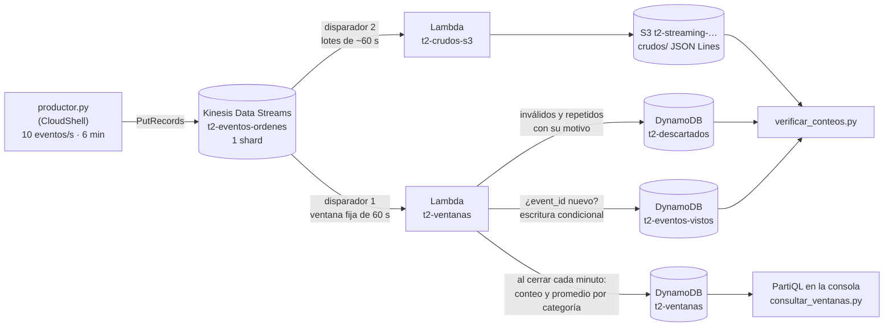

# README · AWS Academy

Trabajo 2 · Parte B en una cuenta de **AWS Academy (Learner Lab)**: streaming con Amazon Kinesis Data Streams, AWS Lambda, Amazon DynamoDB y Amazon S3

La cuenta del Free Tier (Free plan) no tiene disponible Kinesis Data Streams, así que la parte B se monta en la cuenta de AWS Academy. Esta guía está completa: tiene los conceptos, el diseño, lo que hace el código, todos los pasos en la consola, los resultados esperados y cómo borrar todo al final.

- [README · AWS Academy](#readme--aws-academy)
  - [Resumen](#resumen)
    - [Arquitectura](#arquitectura)
    - [Nombres de los recursos](#nombres-de-los-recursos)
    - [Lo particular de AWS Academy](#lo-particular-de-aws-academy)
    - [Estructura de esta carpeta](#estructura-de-esta-carpeta)
  - [Conceptos](#conceptos)
  - [Diseño](#diseño)
    - [Los eventos](#los-eventos)
    - [Eventos inválidos y su motivo](#eventos-inválidos-y-su-motivo)
    - [Eventos repetidos](#eventos-repetidos)
    - [Las ventanas de un minuto](#las-ventanas-de-un-minuto)
    - [Las tablas de DynamoDB y sus llaves](#las-tablas-de-dynamodb-y-sus-llaves)
    - [Cómo cuadran los conteos](#cómo-cuadran-los-conteos)
    - [Por qué Lambda y no Managed Service for Apache Flink](#por-qué-lambda-y-no-managed-service-for-apache-flink)
  - [Preparación](#preparación)
    - [Paso 0.1: Iniciar el laboratorio y entrar a la consola](#paso-01-iniciar-el-laboratorio-y-entrar-a-la-consola)
    - [Paso 0.2: Región, Account ID y LabRole](#paso-02-región-account-id-y-labrole)
    - [Paso 0.3: CloudFormation sin stacks](#paso-03-cloudformation-sin-stacks)
  - [El stream y el productor](#el-stream-y-el-productor)
    - [Paso 1: Crear el stream de Kinesis](#paso-1-crear-el-stream-de-kinesis)
    - [Paso 2: Abrir CloudShell y subir los scripts](#paso-2-abrir-cloudshell-y-subir-los-scripts)
    - [Paso 3: Probar el productor y ver los eventos en el stream](#paso-3-probar-el-productor-y-ver-los-eventos-en-el-stream)
  - [Almacenamiento](#almacenamiento)
    - [Paso 4: Crear las tres tablas de DynamoDB](#paso-4-crear-las-tres-tablas-de-dynamodb)
    - [Paso 5: Crear el bucket de S3](#paso-5-crear-el-bucket-de-s3)
  - [Consumidores](#consumidores)
    - [Paso 6: Crear la Lambda de ventanas con LabRole](#paso-6-crear-la-lambda-de-ventanas-con-labrole)
    - [Paso 7: Conectar la Lambda de ventanas al stream](#paso-7-conectar-la-lambda-de-ventanas-al-stream)
    - [Paso 8: Crear y conectar la Lambda de eventos crudos](#paso-8-crear-y-conectar-la-lambda-de-eventos-crudos)
  - [Ejecución](#ejecución)
    - [Paso 9: Prueba de punta a punta](#paso-9-prueba-de-punta-a-punta)
    - [Paso 10: Limpiar las pruebas](#paso-10-limpiar-las-pruebas)
    - [Paso 11: Ejecución completa de 6 minutos](#paso-11-ejecución-completa-de-6-minutos)
  - [Resultados](#resultados)
    - [Paso 12: Ventanas en DynamoDB y la pregunta del proyecto](#paso-12-ventanas-en-dynamodb-y-la-pregunta-del-proyecto)
    - [Paso 13: Eventos inválidos y repetidos con su motivo](#paso-13-eventos-inválidos-y-repetidos-con-su-motivo)
    - [Paso 14: Eventos crudos en S3](#paso-14-eventos-crudos-en-s3)
    - [Paso 15: Cuadrar los conteos](#paso-15-cuadrar-los-conteos)
  - [Si CloudShell no está disponible](#si-cloudshell-no-está-disponible)
  - [Créditos, sesiones y costos](#créditos-sesiones-y-costos)
  - [Remove](#remove)
  - [Solución de problemas](#solución-de-problemas)
  - [Declaración de uso de IA](#declaración-de-uso-de-ia)

---

## Resumen

La parte B es un flujo de **streaming**: los eventos llegan uno a uno, de forma continua, y se procesan a medida que llegan, no por lotes programados como en la parte A. Usa el mismo proyecto: las órdenes de la tienda en línea, con las mismas cinco categorías de producto (`Electronics`, `Home`, `Fashion`, `Beauty`, `Grocery`).

1. Un **productor** (`productor/productor.py`), que corre en **AWS CloudShell**, publica **10 órdenes por segundo durante 6 minutos** en un stream de **Amazon Kinesis Data Streams**. A propósito, ~5 % de lo que publica son **copias** de órdenes ya enviadas (repetidos) y ~5 % son **eventos inválidos** (un campo faltante, un monto fuera de rango, un JSON roto, etc.).
2. Dos **consumidores** leen el mismo stream, cada uno por su cuenta:
   - **`t2-ventanas`** (AWS Lambda con *tumbling window* de 60 segundos): aparta los inválidos con su motivo, descarta los repetidos y calcula, **por cada minuto y por categoría, el conteo de órdenes y el promedio de `order_amount`**. Guarda el resultado de cada ventana en **DynamoDB**.
   - **`t2-crudos-s3`** (AWS Lambda): guarda en **S3** todos los eventos **tal como llegan**, sin filtrar nada.
3. Se consulta DynamoDB para responder la pregunta del proyecto: **¿qué categoría tiene el ticket promedio más alto y cuál recibe más órdenes por minuto?**
4. Se demuestra que **los conteos cuadran**: publicados = únicos procesados + repetidos descartados + inválidos descartados.

Todo se crea **a mano en la consola de AWS**, sin CloudFormation, Serverless Framework ni Terraform.

### Arquitectura



Las dos funciones Lambda usan el rol **`LabRole`**, que ya existe en la cuenta de Academy.

### Nombres de los recursos

Todos los recursos van en la región **`us-east-1` (N. Virginia)**. Use exactamente estos nombres: los scripts y las consultas los usan.

| Recurso | Nombre |
| --- | --- |
| Stream de Kinesis Data Streams | `t2-eventos-ordenes` (aprovisionado, **1 shard**) |
| Tabla de DynamoDB de resultados | `t2-ventanas` |
| Tabla de DynamoDB de eventos ya recibidos | `t2-eventos-vistos` |
| Tabla de DynamoDB de descartados | `t2-descartados` |
| Bucket de S3 | `t2-streaming-<ACCOUNT_ID>` (el número de cuenta de 12 dígitos: los nombres de bucket son únicos en todo AWS) |
| Función Lambda, primer consumidor | `t2-ventanas` |
| Función Lambda, segundo consumidor | `t2-crudos-s3` |
| Rol de las dos Lambdas | `LabRole` (ya existe; no se crea) |

### Lo particular de AWS Academy

| Tema | En AWS Academy |
| --- | --- |
| Acceso | No hay usuario de IAM: se entra con **Start Lab** y el botón **AWS** de la página del laboratorio. La sesión dura unas 4 horas; después hay que volver a dar **Start Lab** |
| Región | **`us-east-1` (N. Virginia)**. Learner Lab normalmente solo permite `us-east-1` y `us-west-2` |
| Roles | **No se pueden crear roles de IAM.** Las dos funciones usan el rol existente **`LabRole`**, que ya puede leer Kinesis y escribir en DynamoDB, S3 y CloudWatch Logs. Por eso no hay un paso de permisos |
| Carpeta `iam/` | Sus dos políticas **no se usan** en Academy. Muestran el permiso de mínimo privilegio que se le daría a cada función en una cuenta propia, donde sí se crean roles |
| Presupuesto | No hace falta crear una alerta en Budgets: la página del laboratorio muestra los créditos usados |
| Scripts | Toman la región de CloudShell (variable `AWS_REGION`): en `us-east-1` funcionan sin agregar `--region` |
| **Reset** | El botón **Reset** de la página del laboratorio borra **todo** lo creado en la cuenta. No lo use |

### Estructura de esta carpeta

```text
parte_b/
├── README_ACADEMY.md                  # este paso a paso (cuenta de AWS Academy)
├── productor/
│   └── productor.py                   # publica los eventos en Kinesis (corre en CloudShell)
├── lambda/
│   ├── t2_ventanas.py                 # consumidor 1: valida, quita repetidos, ventanas → DynamoDB
│   └── t2_crudos_s3.py                # consumidor 2: eventos crudos → S3
├── iam/
│   ├── politica_ventanas_dynamodb.json  # mínimo privilegio de t2-ventanas (no se usa en Academy)
│   └── politica_crudos_s3.json          # mínimo privilegio de t2-crudos-s3 (no se usa en Academy)
├── consultas/
│   ├── partiql_dynamodb.sql           # consultas para el editor PartiQL de DynamoDB
│   ├── consultar_ventanas.py          # responde la pregunta del proyecto (CloudShell)
│   ├── verificar_conteos.py           # cuadre: publicados = únicos + repetidos + inválidos
│   └── limpiar_datos.py               # vacía tablas y crudos entre pruebas
└── athena/
    └── consultas_crudos.sql           # opcional: los eventos crudos de S3 con Athena
```

Los manifiestos (`manifiesto_<lote>.csv`) que escribe el productor quedan en CloudShell y no se suben a GitHub (ver `.gitignore`).

---

## Conceptos

Lea esta tabla antes de empezar: estos términos aparecen en todos los pasos.

| Concepto | Qué es, en este trabajo |
| --- | --- |
| **Streaming** | Procesar los datos **mientras llegan**, evento por evento, en vez de esperar a tener un archivo completo (batch, como la parte A). El resultado se actualiza cada minuto. |
| **Evento** | Un mensaje pequeño que describe algo que pasó: aquí, "se creó una orden de 2 unidades de Electronics por 73.950". Es un JSON de una línea. |
| **Amazon Kinesis Data Streams** | Servicio que recibe eventos de muchos productores, los **guarda en orden** durante un tiempo (la *retención*, 24 horas por defecto) y deja que varios consumidores los lean, cada uno a su ritmo. Es como un *log* compartido: leer no borra el evento. |
| **Stream** | El "tubo" con nombre (`t2-eventos-ordenes`) donde se publican los eventos. |
| **Shard** | Una partición del stream, con capacidad fija: **1 MB/s o 1.000 registros/s de escritura** y 2 MB/s de lectura. Un stream con más shards aguanta más tráfico. Aquí basta **1 shard** (se envían 10 eventos/s). |
| **Modo aprovisionado vs. bajo demanda** | Aprovisionado: usted elige el número de shards y paga por shard-hora. Bajo demanda: Kinesis los ajusta solo, pero arranca con **4 shards** y cobra por stream-hora. Aquí se usa **aprovisionado con 1 shard**: es más barato y, sobre todo, con un shard **hay una sola ventana por minuto** (ver [Las ventanas](#las-ventanas-de-un-minuto)). |
| **Registro (record)** | Lo que se guarda en el stream por cada evento: los **datos** (los bytes del JSON), la **clave de partición** y un **número de secuencia**. |
| **Clave de partición (partition key)** | Texto que decide a qué shard va el registro (Kinesis le aplica un *hash*). Aquí es el `event_id`. Con un solo shard todos van al mismo. |
| **Número de secuencia (sequence number)** | Identificador único que Kinesis le asigna a **cada registro** al recibirlo. Crece con el orden de llegada dentro del shard. Dos copias del mismo evento son dos registros con **números de secuencia distintos**. |
| **Productor** | Programa que **escribe** en el stream. Aquí `productor.py`, con la API `PutRecords` (envía hasta 500 registros en una llamada). |
| **Consumidor** | Programa que **lee** del stream. Aquí hay dos, independientes: cada uno lleva su propia posición en el stream (lo que ya leyó). |
| **AWS Lambda** | Servicio que ejecuta una función (código Python) **sin administrar servidores**. Se cobra por invocación y por milisegundos de ejecución. |
| **Disparador (trigger) o *event source mapping*** | La conexión entre el stream y la función. Lambda **sondea** (pregunta) el shard varias veces por segundo, junta registros en un **lote (batch)** y llama a la función con ese lote. |
| **Tamaño de lote y ventana de lote** | *Batch size*: máximo de registros por llamada. *Batch window*: cuántos segundos espera Lambda juntando registros antes de llamar. |
| **Posición inicial (starting position)** | Desde dónde empieza a leer un disparador nuevo: `TRIM_HORIZON` (lo más antiguo que se retiene) o `LATEST` (solo lo que llegue después). Aquí `TRIM_HORIZON`, para no perder eventos. |
| **Ventana fija (*tumbling window*)** | Intervalos de tiempo de igual tamaño, **consecutivos y sin solaparse**: 19:05:00–19:06:00, 19:06:00–19:07:00… Cada evento pertenece a una sola ventana. El disparador de Lambda las calcula de forma nativa con la opción **Tumbling window duration**. |
| **Estado (state)** | Lo que la función acumula durante una ventana (conteos y sumas). Lambda se lo devuelve en la siguiente llamada de la misma ventana. Al terminar el minuto, la llama una última vez con `isFinalInvokeForWindow = true`. |
| **Entrega "al menos una vez"** | Si la función falla, Lambda **reintenta el mismo lote**. Por eso cada escritura debe ser **idempotente**: hacerla dos veces deja el mismo resultado que hacerla una vez. |
| **Amazon DynamoDB** | Base de datos NoSQL de llave-valor, sin servidores. Cada tabla tiene una **llave primaria**: una **llave de partición** (*partition key*) y, opcionalmente, una **llave de ordenamiento** (*sort key*). |
| **Modo bajo demanda (on-demand)** | DynamoDB cobra por cada lectura y escritura, sin reservar capacidad. Absorbe ráfagas sin rechazar escrituras. |
| **Escritura condicional** | `PutItem` con una condición (por ejemplo, "solo si no existe un ítem con este `event_id`"). La condición se evalúa de forma **atómica**: si dos copias llegan casi a la vez, solo una gana. Es la base para descartar repetidos. |
| **Query vs. Scan** | **Query** lee solo los ítems de **una** llave de partición (rápido y barato). **Scan** lee **toda** la tabla y luego filtra. |
| **PartiQL** | Lenguaje parecido a SQL para DynamoDB. La consola tiene un **editor de PartiQL**. |
| **AWS CloudShell** | Una terminal Linux en el navegador, dentro de la consola, **con las credenciales de la sesión del laboratorio ya cargadas** y con Python 3 y `boto3` instalados. Se usa para correr el productor y los scripts sin copiar llaves de acceso a su computador. |
| **boto3** | La librería de Python para llamar las APIs de AWS. |
| **Rol de IAM de una Lambda** | Identidad que asume la función. Su política de confianza permite a `lambda.amazonaws.com` asumirlo; sus políticas de permisos dicen qué puede hacer (leer Kinesis, escribir DynamoDB o S3). En Academy es **`LabRole`**, un rol que la Academy ya creó con permisos amplios. |
| **Mínimo privilegio** | Dar a cada identidad solo los permisos que necesita. `LabRole` no lo cumple (sirve para todos los laboratorios); las políticas de `iam/` muestran cómo sería: `t2-ventanas` solo podría `PutItem`/`GetItem` en las tres tablas, y `t2-crudos-s3` solo `PutObject` en `crudos/`. |
| **CloudWatch Logs** | Donde quedan los `print` de cada Lambda, en el grupo `/aws/lambda/<nombre>`. |
| **JSON Lines** | Un archivo de texto con **un JSON por línea**. Es el formato de los eventos crudos en S3. |

---

## Diseño

Esta sección explica **qué** se construye y **por qué**: léala completa antes de los pasos.

### Los eventos

Cada evento es una orden de la tienda, en una línea JSON:

```json
{"event_id": "3f1c9a2e-8b0d-4c4e-9a51-0e7d6b2f4a11", "lote": "lote-20261103-190512", "order_id": 7345120, "customer_id": 1203344, "product_category": "Electronics", "quantity": 2, "order_amount": 61234.5, "event_time": "2026-11-03T19:05:13.482+00:00"}
```

| Campo | Tipo | Regla de validez |
| --- | --- | --- |
| `event_id` | texto (UUID) | Obligatorio. **Identifica el evento**: dos registros con el mismo `event_id` son el mismo evento |
| `lote` | texto | Obligatorio. Identifica cada ejecución del productor (`lote-AAAAMMDD-HHMMSS`, hora UTC) |
| `order_id`, `customer_id` | entero | Obligatorios |
| `product_category` | texto | **La categoría**: `Electronics`, `Home`, `Fashion`, `Beauty` o `Grocery` |
| `quantity` | entero | De 1 a 5 |
| `order_amount` | número | **El campo numérico que se promedia**. Mayor que 0 y hasta 250.000 (5 unidades × 50.000, el mayor precio) |
| `event_time` | texto | Obligatorio. Hora en que el productor creó el evento |

La categoría de cada evento es `product_category` y el campo numérico que se promedia es `order_amount`.

Para que la pregunta del proyecto tenga una respuesta interesante (en la parte A los datos eran casi uniformes), el productor le da a cada categoría una **frecuencia** y un **rango de precio** distintos:

| Categoría | Frecuencia | Precio unitario | Ticket promedio esperado |
| --- | --- | --- | --- |
| `Grocery` | 30 % | 100 a 1.500 | ~2.000 |
| `Fashion` | 25 % | 500 a 8.000 | ~10.800 |
| `Beauty` | 20 % | 200 a 4.000 | ~5.300 |
| `Home` | 15 % | 2.000 a 20.000 | ~28.000 |
| `Electronics` | 10 % | 8.000 a 50.000 | ~74.000 |

(`order_amount` = cantidad × precio × (1 − descuento), con cantidad de 1 a 5 y descuento de 0 a 30 %.)

### Eventos inválidos y su motivo

`t2-ventanas` revisa cada evento en este orden y lo descarta por la **primera** regla que incumple. El productor envía, en partes iguales, un defecto de cada tipo:

| Código | Motivo que se guarda | Defecto que envía el productor |
| --- | --- | --- |
| E0 | `E0 - JSON malformado` | El JSON cortado a la mitad (no se puede leer) |
| E1 | `E1 - Campo obligatorio faltante: product_category` | Sin la categoría |
| E1 | `E1 - Campo obligatorio faltante: order_amount` | Sin el monto |
| E2 | `E2 - Tipo inválido en order_amount` | `"order_amount": "N/A"` (texto en vez de número) |
| E3 | `E3 - product_category fuera del dominio` | `Toys`, `Books` o `electronics ` (no existe en el catálogo) |
| E4 | `E4 - quantity fuera de rango (1 a 5)` | `"quantity": 0` |
| E4 | `E4 - order_amount fuera de rango (mayor que 0 y hasta 250000)` | `-1500`, `0` o `999999.99` |

Los inválidos **se apartan** en la tabla `t2-descartados`, con `tipo = INVALIDO`, el `motivo` y el texto original (`payload`). No entran en ninguna ventana.

### Eventos repetidos

**Definición del equipo**: un evento es repetido cuando su **`event_id` ya se recibió antes**. El `event_id` lo asigna el productor al crear la orden, así que dos registros con el mismo `event_id` son la misma orden enviada dos veces (por ejemplo, un reintento de red del lado del productor).

El productor repite a propósito ~5 % de los eventos: envía **los mismos bytes** de un evento válido ya publicado. La mitad de las copias son de los **últimos segundos** (caen en la misma ventana que el original) y la otra mitad de **cualquier momento anterior** (caen en otra ventana, minutos después).

Cómo se detectan:

1. Por cada evento válido, `t2-ventanas` intenta escribir en la tabla `t2-eventos-vistos` con la condición **"solo si no existe ya este `event_id`"**.
2. Si la escritura funciona, el evento es **nuevo**: se suma a su ventana.
3. Si DynamoDB responde `ConditionalCheckFailedException`, el `event_id` ya estaba: el evento es **repetido**, se aparta en `t2-descartados` con `tipo = REPETIDO`, el motivo `R1 - Evento repetido: event_id ya recibido` y el número de secuencia de la primera vez (`seq_original`), y **no se cuenta**.

Por qué una tabla de DynamoDB y no solo el estado de la ventana: el estado se borra al cerrar cada minuto, y la mitad de las copias llegan **en otra ventana**. Solo una memoria que dure más que la ventana las reconoce.

**Un detalle importante: los reintentos de Lambda.** Si la función falla a mitad de un lote, Lambda lo reintenta completo, y los eventos que ya alcanzó a registrar parecerían repetidos. Para evitarlo, la condición es en realidad:

```text
attribute_not_exists(event_id) OR seq = :seq
```

"El `event_id` no existe, **o** existe pero lo registró **este mismo registro de Kinesis** (mismo número de secuencia)". Un reintento es el mismo registro (mismo `seq`) y pasa; una copia enviada por el productor es otro registro (otro `seq`) y se rechaza. Así las escrituras son **idempotentes**.

### Las ventanas de un minuto

El disparador de Kinesis de `t2-ventanas` tiene **Tumbling window duration = 60 segundos**. Lambda hace el trabajo de las ventanas:

1. Asigna cada registro a una ventana según la **hora en que llegó al stream** (`ApproximateArrivalTimestamp`). Las ventanas están alineadas al minuto del reloj: 19:05:00–19:06:00, 19:06:00–19:07:00, etc. (hora UTC; Colombia es UTC − 5).
2. Durante el minuto llama a la función varias veces, una por lote de hasta 100 registros. Cada llamada recibe el `state` que devolvió la anterior, y la función le suma los eventos nuevos del lote: por categoría, el conteo, la suma de montos, el mínimo y el máximo.
3. Al terminar el minuto, la llama una vez más con `isFinalInvokeForWindow = true`. Ahí la función calcula **promedio = suma / conteo** y escribe **un ítem por categoría** en `t2-ventanas`.

Con 10 eventos por segundo llegan ~600 registros por minuto: ~540 únicos, que se reparten entre las categorías.

Sobre la hora: la ventana usa la hora de **llegada al stream**, no `event_time` (la hora en que se creó el evento). En este flujo las dos difieren en milisegundos. Si un evento llegara con minutos de retraso, Lambda lo contaría en el minuto en que llegó; un motor como Apache Flink puede agrupar por la hora del evento, con *watermarks*, y esperar a los rezagados.

**Por qué un solo shard:** Lambda calcula las ventanas **por shard**. Con 4 shards habría 4 estados por minuto y cada uno escribiría su resultado parcial sobre el mismo ítem de DynamoDB. Con un shard hay exactamente una ventana por minuto y por categoría. Si se necesitaran más shards, habría que sumar los parciales (por ejemplo con `UpdateItem ... ADD`) o usar Flink.

### Las tablas de DynamoDB y sus llaves

| Tabla | Llave de partición | Llave de ordenamiento | Un ítem es | Por qué esa llave |
| --- | --- | --- | --- | --- |
| `t2-ventanas` | `categoria` (String) | `ventana` (String, inicio de la ventana en ISO 8601) | El resultado de una categoría en un minuto | La pregunta es por categoría: un **Query** por `categoria` trae su serie minuto a minuto, ya **ordenada por tiempo** (las fechas ISO se ordenan bien como texto). Escribir dos veces la misma ventana la sobrescribe |
| `t2-eventos-vistos` | `event_id` (String) | — | Un evento único ya procesado | La escritura condicional necesita que el `event_id` sea la llave |
| `t2-descartados` | `seq` (String, número de secuencia de Kinesis) | — | Un registro descartado (inválido o repetido) | Es único por registro y existe siempre, incluso cuando el evento no tiene `event_id` o ni siquiera es JSON. Un reintento sobrescribe el mismo ítem |

Atributos de cada ítem de `t2-ventanas`: `conteo`, `promedio_monto`, `suma_montos`, `monto_minimo`, `monto_maximo`, `ventana_fin`, `hora_colombia`, `conteo_por_lote` (cuántos de esos eventos vinieron de cada ejecución del productor), `shard` y `calculado_en`.

### Cómo cuadran los conteos

Cada registro que Kinesis acepta termina en **exactamente un** lugar:

```text
registro publicado
  ├─ ¿es válido? no ───────────────────────► t2-descartados, tipo INVALIDO   (inválidos descartados)
  └─ sí ─ ¿event_id ya visto? sí ──────────► t2-descartados, tipo REPETIDO   (repetidos descartados)
                               no ─────────► t2-eventos-vistos + su ventana   (únicos procesados)
```

Por eso: **publicados = únicos procesados + repetidos descartados + inválidos descartados**.

- **Publicados** sale del **manifiesto** que escribe el productor: una fila por registro que Kinesis aceptó, con su número de secuencia y lo que se espera que pase con él.
- `verificar_conteos.py` busca cada número de secuencia del manifiesto en las tablas y cuenta. Además comprueba que **la suma de los conteos de las ventanas = únicos**, que **las líneas en S3 = publicados** y que **cada registro quedó clasificado como el productor esperaba**.

### Por qué Lambda y no Managed Service for Apache Flink

Las ventanas también se podrían calcular con Managed Service for Apache Flink. Se eligió Lambda porque:

| | Lambda con *tumbling window* | Managed Service for Apache Flink |
| --- | --- | --- |
| Ventanas | Nativas en el disparador (un número: 60) | Nativas en Flink (`TUMBLE`), por hora del evento o de llegada |
| Código | Una función de Python que se pega en la consola | Una aplicación Java o PyFlink empaquetada con sus conectores (JAR) y subida a S3 |
| Costo | Prácticamente cero para este volumen | ~US$0,22 por hora mientras la aplicación corre (mínimo 2 KPU), aunque no lleguen eventos: consumiría los créditos de Academy |
| Lo que no hace | Ventanas por hora del evento; ventanas que combinen varios shards | — |

Para 10 eventos por segundo y un equipo que está aprendiendo la consola, Lambda cumple todos los requisitos con menos piezas. Flink sería la opción para miles de eventos por segundo, muchos shards o eventos que llegan desordenados.

---

## Preparación

### Paso 0.1: Iniciar el laboratorio y entrar a la consola

1. Entre a AWS Academy (<https://awsacademy.instructure.com/>) con su usuario del curso. Aparece el **Panel de control** (*Dashboard*) con la tarjeta del curso **AWS Academy Learner Lab**.
2. Haga clic en la tarjeta del curso → en el menú izquierdo del curso, **Módulos** (**Modules**) → **Launch AWS Academy Learner Lab** (puede aparecer como *Iniciar el Learner Lab de AWS Academy*). La primera vez aparece el acuerdo de uso: desplácese hasta el final y acéptelo.
3. Se abre la página del laboratorio, con una terminal negra y, arriba a la derecha, los botones **Start Lab**, **End Lab**, **AWS Details**, **Readme** y **Reset**. Haga clic en **Start Lab**.
4. Espere a que el círculo junto a **AWS** (arriba a la izquierda) pase de rojo a amarillo y luego a **verde** (1 a 3 minutos). Cerca de los botones se ve el tiempo de sesión restante (unas 4 horas) y los créditos usados (por ejemplo `Used $1.2 of $50`).
5. Con el círculo en verde, haga clic en **AWS**: se abre la consola de AWS en otra pestaña, ya con la sesión iniciada. Si no se abre, permita las ventanas emergentes de `awsacademy.instructure.com` en el navegador. **No** inicie sesión con otro usuario.

Esperado: la consola abierta, con un nombre de usuario como `voclabs/user1234567=...` arriba a la derecha.

Cada vez que vuelva a trabajar, repita **Start Lab** y entre por el botón **AWS**: la sesión anterior ya expiró. Los recursos creados en sesiones anteriores siguen ahí.

### Paso 0.2: Región, Account ID y LabRole

1. Arriba a la derecha, en el selector de región, elija **US East (N. Virginia) us-east-1**. Revíselo en **cada** consola que abra: cada servicio recuerda su propia región. IAM y la lista de buckets de S3 muestran **Global**, y es normal.
2. Anote el **Account ID** (12 dígitos): menú del usuario, arriba a la derecha (también aparece en **AWS Details**, en la página del laboratorio). En esta guía, `<ACCOUNT_ID>` es ese número.
3. Compruebe que existe `LabRole`: consola → **IAM** → **Roles** → busque `LabRole`. Puede abrirlo y ver su pestaña **Trust relationships**, que permite a `lambda.amazonaws.com` asumirlo. Si IAM muestra *Access denied* al abrir algo, es normal en Academy: lo importante es que `LabRole` aparezca en la lista de roles al crear la función (paso 6).

Esperado: la región `us-east-1` y el rol `LabRole` en la lista.

### Paso 0.3: CloudFormation sin stacks

Abra **CloudFormation** → **Stacks** en `us-east-1`. Si hay stacks **suyos** de trabajos anteriores, elimínelos (**Delete**); si uno no se deja borrar porque su bucket tiene objetos, vacíe el bucket en S3 (**Empty**) y vuelva a intentar.

En algunas cuentas de Learner Lab aparece un stack que **creó Academy** al preparar el laboratorio (por ejemplo, uno con un nombre largo que empieza por `c` seguido de números). Ese stack no contiene nada de la parte B, y borrarlo puede dañar el laboratorio: no lo borre.

Esperado: **No stacks** con el filtro en **Active**, o solo el stack de Academy. Ningún paso de esta guía crea stacks.

---

## El stream y el productor

### Paso 1: Crear el stream de Kinesis

1. Consola (en `us-east-1`) → busque **Kinesis** → **Amazon Kinesis** → en el menú izquierdo **Data streams** (**Flujos de datos**) → **Create data stream** (**Crear flujo de datos**).
2. **Data stream name**: `t2-eventos-ordenes`.
3. **Data stream capacity** → **Capacity mode**: **Provisioned** (**Aprovisionado**). **No** deje **On-demand**: arranca con 4 shards y las ventanas se partirían (ver [Las ventanas](#las-ventanas-de-un-minuto)).
4. **Provisioned shards**: `1`. Debajo, la consola muestra la capacidad total: 1 MiB/s y 1.000 registros/s de escritura, 2 MiB/s de lectura.
5. **Data stream settings**: deje los valores por defecto (retención de 1 día, sin cifrado del lado del servidor u otros cambios).
6. **Create data stream**.

Esperado: el estado pasa de **Creating** a **Active** en menos de un minuto. En la pestaña **Configuration** se ve **Capacity mode: Provisioned**, **Open shards: 1** y **Data retention period: 1 day**.

Qué acaba de crear: un *log* donde cada evento queda guardado 24 horas, en orden, y del que cualquier número de consumidores pueden leer sin quitárselo a los demás.

Si aparece un error de permisos al crear el stream, vea [Solución de problemas](#solución-de-problemas).

### Paso 2: Abrir CloudShell y subir los scripts

CloudShell es una terminal Linux dentro de la consola, con las credenciales de la sesión ya cargadas. Por eso no hace falta copiar llaves de acceso ni ejecutar `aws configure`.

1. Con la región en **us-east-1**, haga clic en el ícono de terminal **>_** de la barra superior de la consola (o busque **CloudShell**). La primera vez tarda uno o dos minutos en preparar el entorno. Si CloudShell no abre en su cuenta de Academy, use la alternativa de [Si CloudShell no está disponible](#si-cloudshell-no-está-disponible).
2. Compruebe Python, `boto3` y la región. En la terminal escriba:

   ```bash
   python3 --version
   python3 -c "import boto3; print(boto3.__version__)"
   echo $AWS_REGION
   ```

   Esperado: Python 3.9 o superior, una versión de boto3 y **`us-east-1`**. Los scripts usan esa región automáticamente.
3. Suba los cuatro scripts: arriba a la derecha de CloudShell, **Actions** (**Acciones**) → **Upload file** (**Cargar archivo**) → elija el archivo → **Upload**. Repítalo para cada uno:
   - `productor/productor.py`
   - `consultas/consultar_ventanas.py`
   - `consultas/verificar_conteos.py`
   - `consultas/limpiar_datos.py`
4. Compruebe con `ls`.

Esperado:

```text
consultar_ventanas.py  limpiar_datos.py  productor.py  verificar_conteos.py
```

Los archivos quedan en `/home/cloudshell-user`, que se conserva entre sesiones. Si CloudShell se cierra por inactividad (20 a 30 minutos sin escribir nada) o porque terminó la sesión del laboratorio, vuelva a abrirlo: los archivos siguen ahí.

### Paso 3: Probar el productor y ver los eventos en el stream

Esta prueba confirma que el productor puede escribir en el stream, antes de construir los consumidores.

1. En CloudShell:

   ```bash
   python3 productor.py --duracion 20
   ```

   Esperado (los números exactos cambian en cada ejecución):

   ```text
   Lote lote-20261103-184501: publicando en 't2-eventos-ordenes' (us-east-1) durante 20 s, 10 eventos/s, ~5 % repetidos y ~5 % inválidos
   ...
     t=  10 s  publicados=  100  (nuevos 91, repetidos 4, inválidos 5)  rechazados=0
     t=  20 s  publicados=  200  (nuevos 181, repetidos 9, inválidos 10)  rechazados=0

   Lote: lote-20261103-184501
   Publicados (aceptados por Kinesis): 200 en 20.1 s (10.0 eventos/s)
     nuevos (deben quedar como únicos) : 181
     repetidos a propósito             : 9
     inválidos a propósito             : 10
   ...
   Manifiesto: manifiesto_lote-20261103-184501.csv
   ```

2. Vea los eventos **dentro del stream**: Kinesis → `t2-eventos-ordenes` → pestaña **Data viewer** (**Visor de datos**) → **Shard**: `shardId-000000000000` → **Starting position**: **Trim horizon** → **Get records**. Aparece una fila por registro, con su **Partition key**, su **Sequence number**, la hora de llegada y los **Data** (el JSON). Busque uno con `"order_amount": "N/A"` o un JSON cortado: son los inválidos.
3. En la pestaña **Monitoring** del stream, la gráfica **Incoming data - Sum (Count)** (registros entrantes) muestra el pico de la prueba. Las métricas tardan uno o dos minutos en aparecer.

Cómo funciona el productor (`productor.py`):

| Elemento | Qué hace |
| --- | --- |
| Bucle de un segundo | Cada segundo arma 10 eventos y los envía con **una** llamada `PutRecords`; luego espera al segundo siguiente. Así la tasa es constante durante toda la ejecución |
| `rng.random()` por evento | Decide si el evento es inválido (~5 %), una copia de uno anterior (~5 %) o nuevo (~90 %) |
| `historial` | Los bytes de los eventos nuevos ya aceptados. Las copias salen de ahí, así que una copia **siempre** se publica después de su original |
| `evento_invalido()` | Aplica, en rotación, cada uno de los 7 defectos de la tabla de [inválidos](#eventos-inválidos-y-su-motivo) |
| `enviar()` | `PutRecords` puede aceptar unos registros y rechazar otros (por ejemplo, si se excede la capacidad del shard). Solo reintenta los rechazados, con espera creciente. Lo que Kinesis no acepta tras 6 intentos **no** se cuenta como publicado |
| Salto de línea al final de cada JSON | Así, en S3, cada evento queda en su propia línea (JSON Lines) |
| `manifiesto_<lote>.csv` | Una fila por registro aceptado: número de secuencia, shard, tipo esperado (`NUEVO`, `REPETIDO`, `INVALIDO`), motivo esperado, `event_id`, categoría y monto. Es el "publicados" del cuadre |

Opciones: `--duracion` (segundos, por defecto 360), `--tasa` (eventos por segundo, por defecto 10), `--pct-repetidos` y `--pct-invalidos` (por defecto 5), `--semilla` y `--region` (por defecto, la de CloudShell). Con **Ctrl+C** se detiene antes de tiempo y el manifiesto se escribe igual.

Los 200 eventos de esta prueba quedan en el stream 24 horas. Cuando cree los consumidores con posición inicial **Trim horizon**, los van a procesar: es normal y sirve como primera prueba. El paso 10 los limpia antes de la ejecución completa.

---

## Almacenamiento

### Paso 4: Crear las tres tablas de DynamoDB

Repita esto tres veces, una por tabla:

1. Consola (en `us-east-1`) → **DynamoDB** → menú izquierdo **Tables** (**Tablas**) → **Create table** (**Crear tabla**).
2. **Table name** y llaves según esta tabla. El tipo de las llaves es **String** en todas. Los nombres de las llaves distinguen mayúsculas y minúsculas: escríbalos exactamente así.

   | Table name | Partition key | Sort key |
   | --- | --- | --- |
   | `t2-ventanas` | `categoria` | `ventana` |
   | `t2-eventos-vistos` | `event_id` | (vacía) |
   | `t2-descartados` | `seq` | (vacía) |

3. **Table settings**: **Customize settings** (**Personalizar configuración**).
4. **Table class**: **DynamoDB Standard**.
5. **Read/write capacity settings** → **Capacity mode**: **On-demand** (**Bajo demanda**). Así la tabla acepta la ráfaga de escrituras sin rechazos y se paga solo lo que se usa.
6. Lo demás por defecto: sin índices secundarios, cifrado con la llave propiedad de AWS, **Deletion protection** apagado.
7. **Create table**.

Esperado: las tres tablas en **Tables** con **Status: Active** y **Capacity mode: On-demand** (tarda unos segundos cada una).

Opcional: en `t2-eventos-vistos` → pestaña **Additional settings** (**Configuración adicional**) → **Time to Live (TTL)** → **Turn on** → **TTL attribute name**: `expira` → **Turn on TTL**. Cada ítem lleva en `expira` la fecha actual + 14 días, y DynamoDB lo borra solo después de esa fecha. Así la memoria de eventos vistos no crece sin límite. La consecuencia: una copia que llegue **más de 14 días** después de su original ya no se reconocería como repetida.

### Paso 5: Crear el bucket de S3

1. Consola → **S3** → **Buckets** → **Create bucket**.
2. **AWS Region**: **US East (N. Virginia) us-east-1**.
3. **Bucket type**: **General purpose**.
4. **Bucket name**: `t2-streaming-<ACCOUNT_ID>`, por ejemplo `t2-streaming-123456789012`.
5. **Object Ownership**: **ACLs disabled**. **Block all public access**: marcado. **Bucket Versioning**: **Disable**. **Default encryption**: **SSE-S3**.
6. **Create bucket**.

No cree carpetas: la Lambda del paso 8 escribe en `crudos/fecha=AAAA-MM-DD/hora=HH/` y S3 muestra esos prefijos como carpetas solo.

Esperado: el bucket vacío, en la región `us-east-1`.

---

## Consumidores

### Paso 6: Crear la Lambda de ventanas con LabRole

1. Consola (en `us-east-1`) → **Lambda** → **Functions** (**Funciones**) → **Create function** (**Crear función**).
2. **Author from scratch** (**Crear desde cero**).
3. **Function name**: `t2-ventanas`.
4. **Runtime**: **Python 3.13** (o la versión de Python 3 más reciente que ofrezca la lista; el código funciona desde 3.9).
5. **Architecture**: **x86_64**.
6. **Permissions** → despliegue **Change default execution role** → **Use an existing role** (**Usar un rol existente**) → **Existing role**: **`LabRole`**.

   Es la diferencia principal con una cuenta propia: Academy no deja crear roles. Si deja la opción por defecto (**Create a new role with basic Lambda permissions**), la creación de la función falla con un error de permisos de IAM.
7. **Create function**.
8. Pestaña **Code** (**Código**): en el editor está el archivo `lambda_function.py` con un ejemplo. Borre todo su contenido, pegue el de `lambda/t2_ventanas.py` y haga clic en **Deploy** (**Implementar**). Espere el mensaje **Successfully updated the function t2-ventanas**.

   No cambie el nombre del archivo en el editor: la función se llama `lambda_function.py` y el **Handler** (en **Runtime settings**, más abajo en la misma pestaña) es `lambda_function.lambda_handler`, es decir, "la función `lambda_handler` del archivo `lambda_function.py`".
9. Pestaña **Configuration** (**Configuración**) → **General configuration** (**Configuración general**) → **Edit**:
   - **Memory**: `256` MB.
   - **Timeout**: `1` min `0` s. El valor por defecto (3 segundos) no alcanza: un lote de 100 registros hace 100 escrituras en DynamoDB.
   - **Save**.
10. **Configuration** → **Environment variables** (**Variables de entorno**) → **Edit** → **Add environment variable**, tres veces:

    | Key | Value |
    | --- | --- |
    | `TABLA_VENTANAS` | `t2-ventanas` |
    | `TABLA_VISTOS` | `t2-eventos-vistos` |
    | `TABLA_DESCARTADOS` | `t2-descartados` |

    **Save**. El código los lee con `os.environ.get(...)`; así se puede apuntar a otras tablas sin editar el código.
11. Compruebe en **Configuration** → **Permissions** que **Execution role** → **Role name** sea `LabRole`.

**No hay paso de permisos**: `LabRole` ya permite leer Kinesis y escribir en DynamoDB y en CloudWatch Logs. En una cuenta propia, la función tendría su propio rol con la política administrada `AWSLambdaKinesisExecutionRole` (leer el stream) y la política en línea de `iam/politica_ventanas_dynamodb.json`, que permite solo `dynamodb:PutItem` y `dynamodb:GetItem` sobre las tres tablas `t2-...` (**mínimo privilegio**).

Qué hace el código (`t2_ventanas.py`), de arriba abajo:

| Parte | Qué hace |
| --- | --- |
| `validar(evento)` | Las reglas de [inválidos](#eventos-inválidos-y-su-motivo): campos obligatorios (E1), tipos (E2), dominio de la categoría (E3) y rangos (E4). Devuelve el motivo o `None`. Rechaza `True`/`False` en campos numéricos, porque en Python `bool` es un entero |
| `leer_registro(record)` | Kinesis entrega los datos en **base64**: los decodifica, intenta leer el JSON (si falla: E0) y lo valida |
| `registrar_si_es_nuevo()` | La escritura condicional en `t2-eventos-vistos` (ver [repetidos](#eventos-repetidos)). Si falla la condición, pide a DynamoDB el ítem que ya existía (`ReturnValuesOnConditionCheckFailure="ALL_OLD"`) para guardar su `seq` original |
| `descartar()` | Escribe en `t2-descartados` el tipo, el motivo y los primeros 2.000 caracteres del texto original |
| `lambda_handler()` | Recupera el estado de la ventana (`event["state"]`), procesa cada registro del lote y suma los únicos a su categoría. Si **no** es la última llamada de la ventana, devuelve el estado actualizado. Si **es** la última (`isFinalInvokeForWindow`), llama a `escribir_ventana()` |
| `escribir_ventana()` | Un `PutItem` por categoría en `t2-ventanas` con conteo y promedio, e imprime una línea `VENTANA ...` en el log |
| `a_decimal()` | DynamoDB no acepta `float` de Python: los números se guardan como `Decimal` |

El estado se guarda como un texto JSON dentro de `{"agregados": "..."}` porque Lambda espera que el estado sea un mapa de texto a texto.

### Paso 7: Conectar la Lambda de ventanas al stream

1. En la función `t2-ventanas`, en **Function overview** (**Información general de la función**), **+ Add trigger** (**Agregar desencadenador**).
2. **Select a source**: **Kinesis**.
3. Llene:

   | Campo | Valor | Por qué |
   | --- | --- | --- |
   | **Kinesis stream** | `kinesis/t2-eventos-ordenes` | El stream del paso 1 |
   | **Consumer** | (vacío) | Un *consumer* de **enhanced fan-out** le daría a esta función 2 MB/s de lectura propios. No hace falta para 10 eventos/s |
   | **Activate trigger** | Marcado | |
   | **Batch size** | `100` | Hasta 100 registros por llamada |
   | **Starting position** | **Trim horizon** | Empieza por lo más antiguo que hay en el stream; no se pierde nada publicado antes de crear el disparador |
   | **Batch window** | (vacío, 0) | Llama apenas hay registros |
   | **Tumbling window duration** (en **Additional settings**) | `60` | **Las ventanas de un minuto**. Es la configuración central de la parte B |
   | **On-failure destination**, **Retry attempts**, **Maximum age of record** | Por defecto | Si la función falla, Lambda reintenta el lote hasta que funcione. No se salta registros: los conteos no se pierden |
   | **Split batch on error** | Desmarcado | |
   | **Concurrent batches per shard** | `1` | Un solo lote a la vez por shard: se respeta el orden y un original siempre se procesa antes que su copia |
   | **Report batch item failures** | Desmarcado | |

4. **Add**.

Esperado: en **Configuration** → **Triggers**, el disparador de Kinesis con **State: Creating** y, en uno o dos minutos, **Enabled**. Al desplegar sus **Details** se ve **Tumbling window duration: 60** (o `TumblingWindowInSeconds: 60`).

Como la posición inicial es **Trim horizon**, la función empieza de inmediato a procesar los 200 eventos de la prueba del paso 3. Compruébelo:

- **Monitor** → **View CloudWatch logs** → el *log stream* más reciente. Aparecen líneas como `{"ventana": "2026-11-03T18:45:00Z", "registros": 100, "unicos": 91, ...}` y, al cerrar cada ventana, `VENTANA 2026-11-03T18:45:00Z -> ... | Beauty: n=37 promedio=5,301.12 | ...`.
- DynamoDB → **Explore items** (**Explorar elementos**) → `t2-ventanas`: un ítem por categoría y minuto de la prueba.

Si los eventos de la prueba se procesan antes de que el disparador quede en **Enabled**, simplemente aparecen después; espere un par de minutos.

### Paso 8: Crear y conectar la Lambda de eventos crudos

Es el **segundo consumidor** del mismo stream. Repita los pasos 6 y 7 con estas diferencias:

| Campo | Valor |
| --- | --- |
| **Function name** | `t2-crudos-s3` |
| **Execution role** | **Use an existing role** → **`LabRole`** |
| Código | El de `lambda/t2_crudos_s3.py` → **Deploy** |
| **Memory** / **Timeout** | `256` MB / `1` min |
| Variables de entorno | `BUCKET` = `t2-streaming-<ACCOUNT_ID>` y `PREFIJO` = `crudos/` |
| **Batch size** | `1000` |
| **Batch window** | `60` segundos |
| **Starting position** | **Trim horizon** |
| **Tumbling window duration** | (vacío): este consumidor **no** usa ventanas |
| Lo demás del disparador | Igual que en el paso 7 |

Con **Batch window = 60**, Lambda junta hasta un minuto de registros (~600) y llama a la función una vez: queda **un archivo por minuto** en vez de cientos de archivos diminutos.

En una cuenta propia, esta función tendría su propio rol con `AWSLambdaKinesisExecutionRole` y la política de `iam/politica_crudos_s3.json`, que permite solo `s3:PutObject` en `arn:aws:s3:::t2-streaming-*/crudos/*`: escribir, y solo en el prefijo `crudos/` de un bucket `t2-streaming-...`. En Academy, `LabRole` ya cubre esos permisos.

Qué hace el código (`t2_crudos_s3.py`):

- Decodifica cada registro (base64) y lo deja **tal como llegó**: válido, inválido o repetido. Si alguno no termina en salto de línea, se lo agrega, para que cada evento quede en su línea.
- Escribe un archivo `.jsonl` por lote en `crudos/fecha=AAAA-MM-DD/hora=HH/<llegada>-<shard>-<primer número de secuencia>.jsonl`. Las carpetas `fecha=`/`hora=` son particiones al estilo Hive (las mismas de la parte A), útiles si se consulta con Athena.
- El nombre del archivo lleva el número de secuencia del primer registro del lote: si Lambda reintenta el lote, sobrescribe el **mismo** archivo y no duplica eventos.

Esperado: el disparador en **Enabled**, y uno o dos minutos después, en S3, `crudos/fecha=.../hora=.../` con un archivo que tiene los 200 eventos de la prueba (ábralo con **Open** o **Download**).

Por qué una Lambda y no Amazon Data Firehose: Firehose también puede leer el stream y escribir en S3 sin código, y es una alternativa válida. Se usa una Lambda para que los dos consumidores se configuren igual y se expliquen juntos.

---

## Ejecución

### Paso 9: Prueba de punta a punta

Ahora que todo está conectado, una prueba de 90 segundos, y su cuadre.

1. En CloudShell:

   ```bash
   python3 productor.py --duracion 90
   ```

   Anote el lote que imprime al final, por ejemplo `lote-20261103-185210`.
2. Espere **2 minutos** después de que termine: la última ventana se cierra cuando termina su minuto, y la Lambda de crudos espera hasta 60 segundos antes de escribir.
3. Verifique (reemplace el lote y el número de cuenta):

   ```bash
   python3 verificar_conteos.py --lote lote-20261103-185210 --bucket t2-streaming-<ACCOUNT_ID>
   ```

Esperado: `¿Cuadra? ... SÍ`, la suma de las ventanas igual a los únicos, los eventos crudos en S3 iguales a los publicados y todos los registros clasificados como se esperaba (la salida completa está en el [paso 15](#paso-15-cuadrar-los-conteos)). Si no cuadra, vea [Solución de problemas](#solución-de-problemas) antes de seguir.

### Paso 10: Limpiar las pruebas

Antes de la ejecución completa, vacíe las tablas y los crudos, para que en la consola solo aparezcan los datos de esa ejecución:

```bash
python3 limpiar_datos.py --bucket t2-streaming-<ACCOUNT_ID>
```

Escriba `si` cuando lo pida. Borra los **ítems** de las tres tablas y los archivos de `crudos/`; no borra las tablas, el bucket, el stream ni las Lambdas. Los eventos de las pruebas siguen en el stream, pero no se vuelven a procesar: cada disparador ya avanzó su posición más allá de ellos.

Opcional: borre también los manifiestos de las pruebas con `rm manifiesto_*.csv`.

Esperado:

```text
t2-ventanas: 15 ítems borrados
t2-eventos-vistos: 1000 ítems borrados
t2-descartados: 100 ítems borrados
s3://t2-streaming-<ACCOUNT_ID>/crudos/: 3 archivos borrados
```

(los números dependen de cuántas pruebas hizo).

### Paso 11: Ejecución completa de 6 minutos

El productor publica **de forma continua durante 6 minutos**.

1. Revise en la página del laboratorio que queden **al menos 30 minutos de sesión**. Si la sesión termina mientras corre el productor, CloudShell se cierra y hay que repetir la ejecución. Si queda poco, haga **End Lab**, luego **Start Lab** y entre de nuevo por **AWS**: el contador vuelve a unas 4 horas.
2. Deje abiertas, en pestañas del navegador: CloudShell, el stream en Kinesis (pestaña **Monitoring**), la función `t2-ventanas` (**Monitor**) y la tabla `t2-ventanas` en **Explore items**.
3. En CloudShell:

   ```bash
   python3 productor.py
   ```

   Sin argumentos usa los valores por defecto: 360 segundos, 10 eventos/s, 5 % repetidos y 5 % inválidos. Cada 10 segundos imprime cuántos lleva publicados.
4. Mientras corre, siga el flujo en estas consolas:
   - **CloudShell**: el avance del productor.
   - **Kinesis** → **Monitoring**: **Incoming data - Sum (Count)** sube a ~600 registros por minuto (las métricas llegan con uno o dos minutos de retraso).
   - **Kinesis** → **Data viewer**: los registros más recientes.
   - **Lambda** `t2-ventanas` → **Monitor**: **Invocations** e **Iterator age** (cuánto atraso tiene el consumidor frente al stream; debe quedarse en pocos segundos).
   - **CloudWatch** → **Log groups** → `/aws/lambda/t2-ventanas`: una línea `VENTANA ...` al cerrar cada minuto.
   - **DynamoDB** → `t2-ventanas` → **Explore items** → **Run** (o el botón de actualizar): aparecen 5 ítems nuevos (uno por categoría) cada minuto.
5. Al terminar, anote el **lote** y espere **2 minutos**.

Esperado, al final de la salida del productor:

```text
Lote: lote-20261103-190512
Publicados (aceptados por Kinesis): 3600 en 360.2 s (10.0 eventos/s)
  nuevos (deben quedar como únicos) : ~3240
  repetidos a propósito             : ~180
  inválidos a propósito             : ~180
Rechazados por Kinesis tras reintentos (no cuentan como publicados): 0
Manifiesto: manifiesto_lote-20261103-190512.csv
```

Los números exactos varían en cada ejecución (son aleatorios), pero siempre suman los publicados.

Se generan **7 u 8 ventanas**: 6 minutos de envío casi nunca empiezan justo en el segundo 0, así que la primera y la última ventana son **parciales** (tienen menos eventos). Es lo esperado.

---

## Resultados

### Paso 12: Ventanas en DynamoDB y la pregunta del proyecto

**Pregunta del proyecto: ¿qué categoría de producto tiene el ticket promedio (`order_amount`) más alto y cuál recibe más órdenes por minuto?** Sirve para decidir, por ejemplo, en qué categoría conviene reforzar la operación (la de más órdenes por minuto) y en cuál un error de despacho cuesta más (la de ticket más alto).

**En la consola:**

1. DynamoDB → **Tables** → `t2-ventanas` → **Explore table items** (**Explorar elementos de tabla**). Por defecto hace un **Scan** y muestra todos los ítems: `categoria`, `ventana`, `conteo`, `promedio_monto`, etc.
2. Para responder por categoría con un **Query**: elija **Query**, **categoria (Partition key)** = `Electronics` → **Run**. Aparecen solo las ventanas de Electronics, **ordenadas por minuto** (la llave de ordenamiento). Repita con `Grocery` y compare.
3. Con el **PartiQL editor** (**Editor de PartiQL**, menú izquierdo de DynamoDB): pegue la consulta 1 de `consultas/partiql_dynamodb.sql` → **Run**:

   ```sql
   SELECT "ventana", "hora_colombia", "conteo", "promedio_monto", "monto_minimo", "monto_maximo"
   FROM "t2-ventanas"
   WHERE "categoria" = 'Electronics';
   ```

   Filtra por la llave de partición, así que DynamoDB lo resuelve como un Query. Puede ver el resultado como tabla (**Table view**) o como JSON. La consulta 2 muestra las cinco categorías de un mismo minuto (esa es un Scan con filtro, porque no da la llave de partición).

**El resumen completo, en CloudShell:**

```bash
python3 consultar_ventanas.py --lote lote-20261103-190512
```

Esperado (forma; los números cambian en cada ejecución):

```text
Órdenes únicas y ticket promedio por ventana de 1 minuto (n / promedio)

ventana (UTC)         hora Col.             Electronics                  Home               Fashion                Beauty               Grocery
2026-11-03T19:05:00Z  14:05           26 /    70,133.85     38 /    29,486.87     61 /     9,736.12     50 /     5,301.12     70 /     1,937.02
2026-11-03T19:06:00Z  14:06           53 /    62,434.47     88 /    28,090.97    137 /    10,672.76    100 /     4,484.26    146 /     2,108.48
...

Resumen por categoría
categoría      ventanas  órdenes  órdenes/min  ticket promedio  máx. por min
Electronics           7      324         46.3        73,512.40            61
Home                  7      486         69.4        28,120.11            92
Fashion               7      810        115.7        10,804.67           152
Beauty                7      648         92.6         5,295.03           110
Grocery               7      972        138.9         2,041.88           171

Respuesta:
  Ticket promedio más alto : Electronics (73,512.40 por orden)
  Más órdenes por minuto   : Grocery (138.9 órdenes/min)
```

Interpretación: **Electronics** tiene el ticket promedio más alto (~74.000 por orden, unas 36 veces el de Grocery) aunque es la categoría con **menos** órdenes; **Grocery** recibe más órdenes por minuto pero con el ticket más bajo. El ticket promedio de cada categoría se calcula como **suma de montos / número de órdenes** de todas sus ventanas, y no como el promedio de los promedios de cada minuto, porque cada minuto tiene un número distinto de órdenes (las ventanas parciales pesarían igual que las completas). Las cifras reflejan cómo se diseñó el productor (tabla de [Los eventos](#los-eventos)).

`python3 consultar_ventanas.py --categoria Electronics` hace la misma consulta para una sola categoría, con un Query.

### Paso 13: Eventos inválidos y repetidos con su motivo

1. DynamoDB → `t2-descartados` → **Explore table items**. Cada ítem tiene `seq`, `tipo` (`INVALIDO` o `REPETIDO`), `motivo`, `payload` (el texto original), `llegada` y `ventana`.
2. Para ver solo los inválidos: en **Filters** (**Filtros**) agregue `tipo` = `INVALIDO` (tipo String) → **Run**. O en el editor PartiQL, la consulta 3 de `partiql_dynamodb.sql`:

   ```sql
   SELECT "seq", "motivo", "payload", "llegada" FROM "t2-descartados" WHERE "tipo" = 'INVALIDO';
   ```

   Abra algunos: uno `E0 - JSON malformado` (el `payload` está cortado), uno `E2 - Tipo inválido en order_amount` (`"order_amount": "N/A"`), uno `E4 - order_amount fuera de rango ...`.
3. Los repetidos: consulta 4 (`WHERE "tipo" = 'REPETIDO'`). Copie un `event_id` y búsquelo en `t2-eventos-vistos` con la consulta 5: aparece **una sola vez**, con el `seq` de su primera llegada, igual al `seq_original` del repetido. Esa es la prueba de que se contó una sola vez.

### Paso 14: Eventos crudos en S3

1. S3 → `t2-streaming-<ACCOUNT_ID>` → `crudos/` → `fecha=2026-11-03/` → `hora=19/` (hora UTC). Hay **un archivo `.jsonl` por minuto**, aproximadamente.
2. Marque un archivo → **Open** (o **Download**) → se ve un evento por línea, **tal como llegaron**: los válidos, las copias repetidas (busque con Ctrl+F un `event_id` repetido: aparece dos veces) y los inválidos, incluido el JSON cortado.

Los crudos son la capa **bronce** (la parte A tenía `raw/`): si mañana cambia una regla de validación o aparece un error en la Lambda, se pueden reprocesar desde S3, aunque el stream ya haya borrado los eventos (retiene 24 horas).

Opcional, con Athena (`athena/consultas_crudos.sql`):

1. Consola (en `us-east-1`) → **Athena** → **Query editor**. Si es la primera vez en la cuenta de Academy, Athena pide una ubicación de resultados: **Settings** → **Manage** → **Location of query result**: `s3://t2-streaming-<ACCOUNT_ID>/athena-results/` → **Save**.
2. En el archivo, reemplace `<BUCKET_B>` por `t2-streaming-<ACCOUNT_ID>` y `<LOTE>` por el lote de la ejecución completa.
3. Ejecute las sentencias **una a una**, en orden:
   - la 1 crea la base `trabajo2` (en Academy no existe todavía);
   - la 2 crea la tabla `trabajo2.eventos_crudos`, con una sola columna de texto, `linea`, para que quepan también las líneas que no son JSON válido;
   - la 3 (`MSCK REPAIR TABLE`) registra las carpetas `fecha=`/`hora=` como particiones;
   - la 4 cuenta los eventos crudos del lote (debe dar los publicados);
   - la 5 lista los `event_id` que aparecen más de una vez;
   - la 6 muestra las líneas que no son JSON (los inválidos E0).

### Paso 15: Cuadrar los conteos

En CloudShell, en la carpeta donde quedó el manifiesto (la de inicio):

```bash
python3 verificar_conteos.py --lote lote-20261103-190512 --bucket t2-streaming-<ACCOUNT_ID>
```

Esperado (con los números de su ejecución):

```text
=== Conteos del lote lote-20261103-190512 ===
Publicados (manifiesto del productor)          :   3600
Únicos procesados        (t2-eventos-vistos)   :   3243   esperado 3243
Repetidos descartados    (t2-descartados)      :    178   esperado 178
Inválidos descartados    (t2-descartados)      :    179   esperado 179
Únicos + repetidos + inválidos                 :   3600
¿Cuadra? (publicados = únicos + rep. + inv.)   : SÍ

Comprobaciones cruzadas
Suma de 'conteo' de las ventanas (t2-ventanas) :   3243   = únicos
Eventos crudos en S3 (7 archivos)              :   3600   = publicados
Registros clasificados como se esperaba        :   3600 de 3600

Inválidos descartados por motivo
  E0 - JSON malformado                                             26
  E1 - Campo obligatorio faltante: order_amount                    25
  E1 - Campo obligatorio faltante: product_category                26
  E2 - Tipo inválido en order_amount                               25
  E3 - product_category fuera del dominio                          26
  E4 - order_amount fuera de rango (mayor que 0 y hasta 250000)    25
  E4 - quantity fuera de rango (1 a 5)                             26
```

Cómo se lee:

```text
3.600 publicados
 = 3.243 únicos procesados       (cada uno sumado una vez en su ventana)
 +   178 repetidos descartados   (copias de event_id ya vistos)
 +   179 inválidos descartados   (con su motivo)
```

- **Únicos = suma de las ventanas**: cada evento único se contó en exactamente una ventana, y ningún repetido entró en una.
- **Crudos = publicados**: el segundo consumidor guardó todo, incluidos repetidos e inválidos, porque no filtra.
- **Clasificados como se esperaba**: el productor anotó en el manifiesto qué debía pasar con cada registro (`NUEVO`, `REPETIDO` o `INVALIDO` y el motivo), y el consumidor hizo exactamente eso con cada uno.

Una vista más en la consola, sin scripts: en **Explore items** de cada tabla, la consola muestra cuántos ítems devolvió el Scan. Después del paso 10 las tablas solo tienen la ejecución completa, así que `t2-eventos-vistos` tiene tantos ítems como únicos y `t2-descartados` tantos como repetidos + inválidos (la cuenta de ítems de la pestaña **Overview** de cada tabla se actualiza solo cada ~6 horas: no la use).

---

## Si CloudShell no está disponible

Si CloudShell no abre en su cuenta de Academy, ejecute los scripts en su computador con las credenciales temporales del laboratorio:

1. En la página del laboratorio → **AWS Details** → **AWS CLI**: **Show**. Aparece un bloque `[default]` con `aws_access_key_id`, `aws_secret_access_key` y `aws_session_token`.
2. Copie ese bloque completo en el archivo de credenciales de su computador:
   - Windows: `C:\Users\<usuario>\.aws\credentials`
   - Linux o macOS: `~/.aws/credentials`

   Cree la carpeta `.aws` si no existe. Reemplace el contenido anterior de `[default]`.
3. Instale boto3 (`python -m pip install boto3` en Windows) y ejecute los scripts desde la carpeta `parte_b`, agregando `--region us-east-1`, porque su computador no tiene la variable `AWS_REGION` de CloudShell:

   ```powershell
   python productor/productor.py --region us-east-1
   python consultas/verificar_conteos.py --lote <LOTE> --bucket t2-streaming-<ACCOUNT_ID> --region us-east-1
   ```

   En Windows use `python` o `py`, no `python3`. `verificar_conteos.py` busca el manifiesto en la carpeta actual: páselo con `--manifiesto manifiesto_<LOTE>.csv` si quedó en otra.
4. Estas credenciales **expiran con la sesión** del laboratorio: después de cada **Start Lab**, cópielas de nuevo.

**Nunca comparta este bloque ni el archivo `credentials`**: son credenciales de AWS.

---

## Créditos, sesiones y costos

- La página del laboratorio muestra los créditos usados (por ejemplo `Used $3.4 of $50`). Si se acaban, el laboratorio se bloquea y se pierden los recursos: cuídelos.
- Al terminar la sesión (unas 4 horas) o al pulsar **End Lab**, el laboratorio se apaga, pero los recursos de la parte B **se conservan**: el stream, las tablas, las funciones y el bucket siguen ahí en la siguiente sesión.
- **Reset** en la página del laboratorio borra **todos** los recursos de la cuenta. No lo use mientras necesite los recursos.

Lo que consume créditos (precios de AWS en `us-east-1`, octubre de 2026):

| Servicio | Cómo cobra | Estimado |
| --- | --- | --- |
| Kinesis Data Streams (aprovisionado) | US$0,015 por shard-hora, **mientras el stream exista**, aunque no reciba nada y aunque la sesión esté apagada; más US$0,014 por millón de unidades PUT | 1 shard: **US$0,36 al día**. Cada ejecución de 3.600 eventos: menos de un centavo |
| Lambda | Por invocación y por GB-segundo | Unas pocas miles de invocaciones: **centavos o menos** |
| DynamoDB bajo demanda | ~US$0,625 por millón de escrituras y ~US$0,125 por millón de lecturas; ~US$0,25 por GB-mes | ~4.000 escrituras por ejecución: **menos de un centavo** |
| S3 | ~US$0,023 por GB-mes | ~1 MB por ejecución: **US$0** |
| CloudWatch Logs | US$0,50 por GB ingerido | Pocos MB: **centavos** |
| CloudShell | Sin costo | **US$0** |
| Athena (opcional) | US$5 por TB leído | Unos MB: **US$0** |

Total: lo que más pesa es mantener el stream creado. Una semana son ~US$2,50 de los créditos. Si prefiere ahorrarlos, borre el stream cuando no lo use y créelo de nuevo (paso 1) cuando lo necesite. En ese caso, borre los dos disparadores en **Configuration** → **Triggers** de cada función y créelos otra vez (pasos 7 y 8), porque los anteriores apuntan al stream borrado y dejan de funcionar.

---

## Remove

Ejecute esta sección solo cuando ya no necesite los recursos.

En `us-east-1`, en este orden:

1. **Lambda** → `t2-ventanas` → **Configuration** → **Triggers** → marque el disparador de Kinesis → **Delete**. Lo mismo en `t2-crudos-s3`. Luego **Functions** → marque las dos funciones → **Actions** → **Delete**.
2. **Kinesis** → **Data streams** → `t2-eventos-ordenes` → **Actions** → **Delete** (escriba `delete`).
3. **DynamoDB** → **Tables** → marque `t2-ventanas`, `t2-eventos-vistos` y `t2-descartados` → **Delete** (escriba `confirm`; no cree copia de seguridad).
4. **Athena** (solo si hizo la parte opcional) → `DROP TABLE trabajo2.eventos_crudos;` y luego `DROP DATABASE trabajo2;`.
5. **S3** → `t2-streaming-<ACCOUNT_ID>` → **Empty** (escriba `permanently delete`) → **Delete**.
6. **CloudWatch** → **Log groups** → `/aws/lambda/t2-ventanas` y `/aws/lambda/t2-crudos-s3` → **Actions** → **Delete log group(s)**.
7. **CloudShell** (opcional) → **Actions** → **Delete** borra el directorio de inicio con los scripts y manifiestos.

**No borre `LabRole`**: es de Academy. No hay roles propios que borrar.

Esperado: ningún recurso `t2-...` de la parte B en las consolas, y CloudFormation sin stacks (o solo con el de Academy).

---

## Solución de problemas

| Síntoma | Causa probable | Solución |
| --- | --- | --- |
| Error al crear la función: *not authorized to perform: iam:CreateRole* | Quedó la opción por defecto **Create a new role with basic Lambda permissions** | Paso 6.6: **Use an existing role** → `LabRole` |
| `LabRole` no aparece en la lista de roles | La lista no cargó, o se está en otra cuenta | Recargar la página; confirmar que entró por el botón **AWS** del laboratorio |
| *You are not authorized* / `AccessDenied` al crear recursos | La región no está permitida en Learner Lab | Cambiar a **us-east-1** |
| Error de permisos al crear el stream o al elegir el número de shards | Academy limita algunas opciones de Kinesis | Confirmar **Provisioned** con **1** shard; si aun así falla, consultar a quien administra el curso en Academy |
| La consola dice que la sesión expiró, o los scripts responden `ExpiredToken` | Terminó la sesión del laboratorio | **Start Lab** de nuevo y entrar por **AWS**; si usa su computador, copiar las credenciales nuevas |
| `ResourceNotFoundException` al correr el productor | El stream no existe en esa región o tiene otro nombre | Revisar que CloudShell esté en `us-east-1` (`echo $AWS_REGION`) y el nombre `t2-eventos-ordenes` |
| `echo $AWS_REGION` muestra otra región | CloudShell se abrió con otra región seleccionada | Cerrar CloudShell, elegir **us-east-1** en el selector y abrirlo de nuevo |
| Al crear el disparador: *The provided execution role does not have permissions to call GetRecords on Kinesis* | La función no tiene `LabRole` | **Configuration** → **Permissions** → **Edit** → **Existing role**: `LabRole` → **Save**; esperar 10 segundos y reintentar |
| En el log: `AccessDeniedException ... dynamodb:PutItem` o `AccessDenied ... PutObject` | La función no tiene `LabRole`, o la tabla o el bucket están en otra región | Revisar el rol de la función y que todo esté en `us-east-1` |
| En el log: `KeyError: 'BUCKET'` | Falta la variable de entorno en `t2-crudos-s3` | Paso 8, variables de entorno |
| En el log: `Task timed out after 3.00 seconds` | No se cambió el **Timeout** | Paso 6.9: 1 minuto |
| `Runtime.ImportModuleError` o `Handler 'lambda_handler' missing` | Se cambió el nombre del archivo en el editor o no se hizo **Deploy** | El archivo debe ser `lambda_function.py`, el handler `lambda_function.lambda_handler`; volver a pegar y **Deploy** |
| `t2-ventanas` queda vacía pero hay ítems en `t2-eventos-vistos` | Falta **Tumbling window duration** en el disparador: sin ventanas, nunca llega `isFinalInvokeForWindow` | Editar el disparador (**Configuration** → **Triggers** → **Edit**) y poner `60` |
| Ítems en `t2-ventanas` con conteos que parecen partidos o se sobrescriben | El stream tiene más de un shard (por ejemplo, se creó **On-demand**) | Borrar el stream y crearlo **Provisioned** con 1 shard (paso 1); volver a crear los disparadores |
| La suma de las ventanas es menor que los únicos | La última ventana no se ha cerrado | Esperar 1 o 2 minutos más y volver a verificar |
| Los crudos en S3 son menos que los publicados | La Lambda de crudos espera hasta 60 s (**Batch window**) antes de escribir | Esperar y volver a verificar |
| `verificar_conteos.py`: `FileNotFoundError: manifiesto_...csv` | Se ejecutó en otra carpeta o con otro lote | `ls manifiesto_*` y copiar el lote exacto |
| El **Iterator age** de una Lambda crece sin parar | La función falla una y otra vez con el mismo lote y Lambda lo reintenta | Ver el error en sus logs, corregir y **Deploy**: el lote se reprocesa solo, sin perder ni duplicar (las escrituras son idempotentes) |
| Los repetidos son más que los esperados | El productor reintentó a nivel de red un `PutRecords` que sí había llegado | El verificador cruza por número de secuencia y no se afecta; la copia extra queda bien clasificada como repetida |
| Las horas de las ventanas no coinciden con la hora de Colombia | Las ventanas están en UTC | Restar 5 horas; el atributo `hora_colombia` ya viene convertido |
| PartiQL: `ValidationException` en la consulta | Comillas cambiadas | Nombres de tabla y atributos con comillas dobles (`"t2-ventanas"`), valores con comillas simples (`'Electronics'`) |
| CloudShell se cerró a mitad del productor | Terminó la sesión del laboratorio, o más de 20 minutos sin interacción | Volver a ejecutar el productor: genera un lote nuevo y el anterior queda incompleto (no use su manifiesto) |
| Athena: *No output location provided* | Falta la ubicación de resultados | Paso 14, Athena, punto 1 |
| Los recursos "desaparecieron" | Se está mirando otra región, o se pulsó **Reset** | Revisar el selector de región; un **Reset** obliga a crear todo de nuevo |

---

## Declaración de uso de IA

- Se usó claude como guía para el diseño del flujo: Kinesis con un shard, dos consumidores Lambda, tres tablas de DynamoDB.
- El productor `productor/productor.py`, que publica los eventos en el stream.
- El código de las dos funciones Lambda de `lambda/`.
- Los scripts de `consultas/`: `consultar_ventanas.py`, `verificar_conteos.py` y `limpiar_datos.py`.
- Esta guía construida a partir del historial del chat con el que se exploró la consola de AWS.

El equipo creó cada recurso en la cuenta de AWS Academy manualmente, ejecutó el flujo y verificó que los conteos cuadraran.